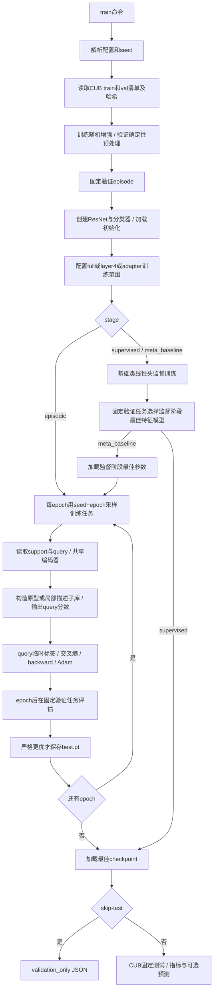
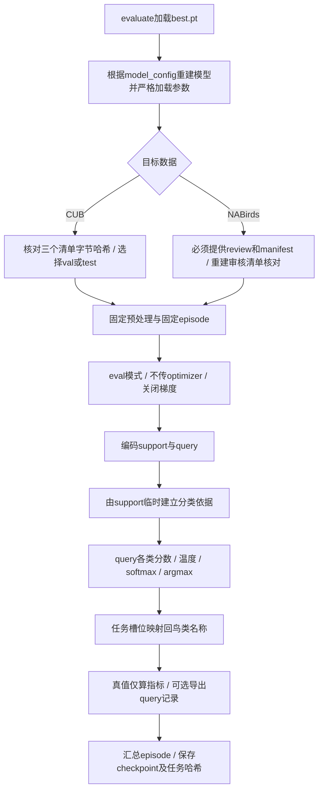

# 项目结构与真实执行路径

审计基线：分支 `test/cross-dataset`，提交 `6cd53e9`。以本轮文件快照为准，不沿用先前会话中的环境判断。只新增本目录文档和审计证据；未改源代码、数据清单、历史报告或权重。113 个原有受保护文件前后 SHA256 一致，见 [preservation.json](evidence/preservation.json)。

## 证据边界

- **静态调用确认**：从命令入口可追踪到对应分支，不能等同已经在真实训练中运行。
- **本轮运行验证**：标准库检查、真实数据元信息检查及抽样图像解码；结果见 [stdlib_checks.json](evidence/stdlib_checks.json)。抽取 AST 只执行原始标准库函数定义，明确排除不可用的 torch 导入；没有模拟 torch，也没有把这些检查当成模型前向测试。
- **历史结果**：报告和 JSON 存在，但缺训练检查点、逐轮日志、原始预测和任务计划；只能检查内部一致性。
- **模型运行阻塞**：项目 Python 3.11.18 环境没有 torch、torchvision、numpy、scipy、Pillow、pytest；系统 Python 3.14 有 Pillow/NumPy/pytest，但无 torch/scipy，且超出项目 Python 约束。没有安装依赖或下载权重。

## 目录实查

| 位置 | 实际内容 | 审计判断 |
|---|---|---|
| `src/pattern_recognition_coursework/` | 15 个 Python 文件，数据、模型、引擎、分析 | 主实现 |
| `scripts/` | 9 个 Python 工具 | 数据验证、导入、消融、审计 |
| `tests/` | 10 个 Python 测试文件 | 存在测试代码，本轮原套件未成功收集 |
| `pyproject.toml`、`uv.lock` | Python >=3.11,<3.12；52 个 lock 包条目 | TOML 可解析，不代表依赖已安装 |
| `configs/` | 不存在 | 实验配置来自 argparse；没有独立 YAML 实验矩阵 |
| `data/splits/` | CUB 六份版本化类别/图像清单 | 有效，100/50/50 类及 5890/2947/2951 图 |
| `cub2002011/versions/7/CUB_200_2011/` | CUB 原始图像和官方元信息 | 数据实际在此，入口默认 `data/raw/CUB_200_2011` 不存在 |
| `nabirds/` | 48562 张索引图像、元信息及数据集附带代码 | 不是项目默认 `data/raw/nabirds`；附带 `nabirds.py` 没有被项目入口调用 |
| `nabirds.tar.gz` | 已有约 9.88 GB 压缩包 | 本轮未解压、未重新下载、未整包哈希 |
| `data/splits/nabirds_review.json`、`nabirds_test.json` | 不存在 | 正式跨数据集测试尚未具备物种审核条件 |
| `outputs/` | 不存在 | 历史运行目录不在当前工作区 |
| `outputs/cub_preview/` | 11 文件：统计 CSV、JSON、Markdown、8 张预览 | 数据预览，不是模型预测成绩；使用 CUB 官方图像级 train/test 标记，不等同项目类别级划分 |
| `reports/records/` | 7 JSON、2 CSV | 历史结果、来源和错误审计记录 |
| 模型/日志 | 项目扫描未找到 `.pt/.pth/.ckpt`、`metrics.json/history.json` 或 TensorBoard 事件 | 无法重放历史真实推理；LaTeX build 日志不是训练日志 |

完整目录后缀计数见 [inventory.json](evidence/inventory.json)。图像、Git 数据库及虚拟环境不作为项目模型检查点候选。

## 模块、输入输出与调用关系

以下位置均相对仓库根目录；行号来自当前文件。

| 模块与定义 | 谁调用 | 输入 → 输出 | 实际路径及证据 |
|---|---|---|---|
| `__init__.py:4 main` | pyproject 控制台入口 | command → train/evaluate/select/summarize | 静态确认；依赖缺失无法实际启动模型命令 |
| `data/cub_dataset.py:10 get_cub_transforms` | experiment/evaluate | 分辨率与训练标志 → transform | 静态进入所有主路径；torchvision 未验证 |
| `data/cub_dataset.py:35 CUBFewShotDataset` | experiment/evaluate | 图像清单 → `(RGB张量, split内标签)` | Dataset 完整运行受阻；官方元信息单独验证通过 |
| `data/cub_dataset.py:99 FewShotBatchSampler` | experiment:308、episodes:62 | 每类索引及 way/shot/query → support后query的索引列表 | 原函数标准库抽取执行通过；内容重复缺陷已复现 |
| `data/episodes.py:10/25/54` 指纹、校验、读写任务 | experiment:create_plan、evaluate:83 | dataset及JSON → 固定批次 | 指纹与校验函数抽取验证；本轮不写正式 episode |
| `data/nabirds.py:65/99/128/205` 元信息、审核、建表、Dataset | prepare_nabirds/evaluate:74 | 层级与人工审核 → 物种清单/图片 | 真实元信息及待审核候选生成在内存通过；审核、真实 Dataset 推理未运行 |
| `data/import_nabirds.py:49 import_archive` | scripts/import_nabirds | 官方包 → data/raw/nabirds | 路径、链接、完整性检查静态可见；未重复解压大数据 |
| `models/backbones/resnet.py:85/112` | FewShotModel:62/97 | 图像 → 全局 `[B,512]` 或空间 `[B,512,H,W]` | torchvision ResNet-18，fc=Identity；缺权重与 torch，未实际前向 |
| `models/backbones/resnet.py:14 load_backbone_weights` | make_backbone | 本地 state_dict及明确前缀 → 严格加载 | 键、形状、完整头成对排除；不能据此证明历史权重已加载 |
| `models/few_shot.py:83/90/112` | run_episodes | 图片 → 嵌入 → `[NQ,N]` 分数 | 五种 method 分支静态确认；尚无本轮模型运行证据 |
| `models/metrics/episode.py:9/18` | few_shot:131/133、compare脚本 | support/query向量 → 标准化/原型分数 | 核心公式已静态审查，torch数学测试阻塞 |
| `models/metrics/local.py:7` | few_shot:124、compare脚本 | `[NK,C,H,W]`和`[NQ,C,H,W]` → `[NQ,N]` | 真正按类池化描述子、余弦top-k平均；不是拼接 |
| `models/metrics/context.py:7` | method=matchingnet_fce | support/query全局向量 → 上下文特征 | BiLSTM及query注意力LSTM；是否严格复现论文未作外部核验 |
| `engine/experiment.py:66/97/128/200` | train入口 | 参数配置与图像 → checkpoint、训练及评估JSON | 三训练阶段完整静态路径；历史真实运行无法复核 |
| `engine/evaluate.py:18` | evaluate入口 | checkpoint与清单 → 指标、可选逐query JSONL | CUB/NABirds复用run_episodes，不传optimizer，无测试反传 |
| `analysis/metrics.py:16/72` | run_episodes | 分数和query标签 → episode指标及均值 | 无模型成绩硬编码；全局物种混淆矩阵未实现 |
| `analysis/select.py:12` | select入口 | 多种子验证结果 → 最佳融合权重 | 标准库函数抽取验证通过；不能证明输入JSON来源真实 |
| `analysis/summarize.py:71/99/122` | summarize入口 | 多种子评估JSON → 增益/泛化差距和t区间 | 同checkpoint校验不足，合成记录已复现；真实多种子推理缺失 |

## 训练流程

`run_episodes:99–113`：有 optimizer 时 train+梯度更新；否则 eval+关闭梯度。标签为 `arange(N).repeat_interleave(Q)`，依赖采样器排列；Dataset 返回的原始标签被忽略。support不直接产生监督损失，但其特征形成原型，梯度可经原型回到编码器。`meta_baseline` 在 episodic 阶段重置最佳值，最终不是在两个阶段的全部checkpoint间统一选优。

## 预测流程与尺寸

以5-way、5-shot、每类1 query、224像素为例：30张图 `[30,3,224,224]` → 空间 `[30,512,7,7]`。全局分支GAP后 `[30,512]`，25 support按5类均值得 `[5,512]` 原型，5 query产生 `[5,5]` 分数。局部分支每图49个描述子，每类support库245个描述子，query每个位置在每个类别找top-k，平均后同样得到 `[5,5]`。

融合模型共享同一个骨干；`s=(1-λ)sg+λsl`，再除共同温度。局部模型adapter作用于每个空间位置；全局模型adapter作用于GAP向量。adapter无偏置、512→512、恒等初始化，共262144参数。本实现不在测试support上进行梯度适配。新类别由support临时指定，不由固定100类头直接预测。

## 配置与默认值风险

CLI 默认 `metric=euclidean`、`n_query=5`、`image_size=224`、`eval_episodes=100`；历史主要实验每类1 query。选择 `global_local` 并不自动强制余弦，复现报告方案必须显式 `--metric cosine`。DN4/Matching内部固定余弦，CLI却要求保留默认euclidean占位值（few_shot:42–43）；元数据需解释，不能把它误读为这些方法使用欧氏。

源码默认输出仍是 `outputs/`，只改 `.gitignore` 不会改变运行位置。新实验若希望纳入 `outputs/` 管理，需显式 `--output-dir outputs/<新运行组>`；大checkpoint不宜直接进入Git，建议存外部并版本化校验清单。本轮不改这些配置。
