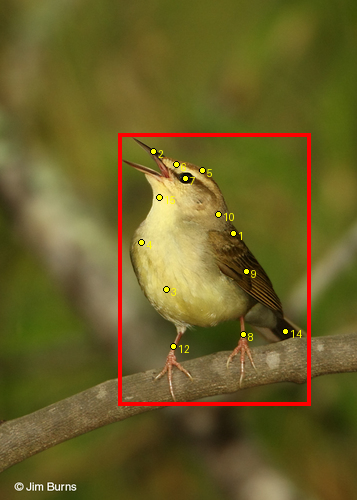
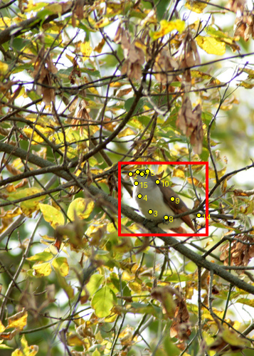
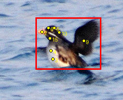
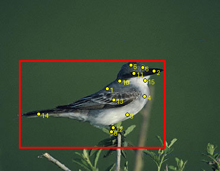
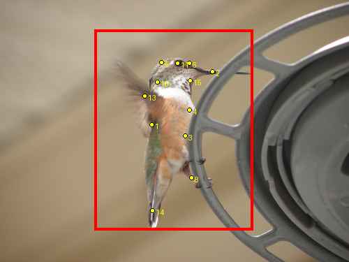
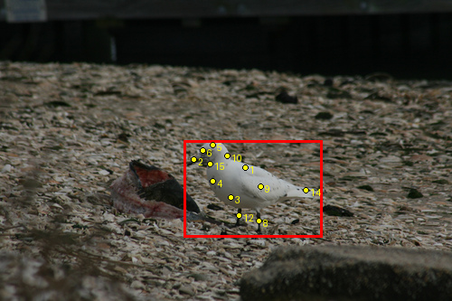
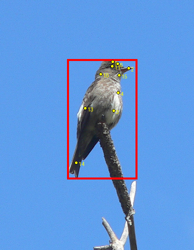
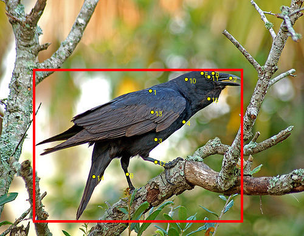

# CUB-200-2011 数据预览

- 类别数：**200**；索引样本数：**11788**。
- 每类图像数：平均 **58.94** 张，最少 **41** 张，最多 **60** 张。完整逐类统计见 [class_counts.csv](class_counts.csv)。
- 官方按图像划分：训练 **5994** 张，测试 **5794** 张。
- 磁盘 JPG：**11796** 个；其中 **8** 个不在 `images.txt` 中。
- 图像、标签及标注对应关系：**通过**。

## 数据位置和连接方式

数据根目录：`/home/caesar/Projects/few-shot-fine-grained-generalization/cub2002011/versions/7/CUB_200_2011`

| 内容 | 相对数据根目录路径 | 字段与用途 |
| --- | --- | --- |
| 图像 | `images/<类别目录>/<图片名>.jpg` | 按类别分目录存放 |
| 图像索引 | `images.txt` | `image_id 相对图像路径` |
| 类别名称 | `classes.txt` | `class_id 类别名称` |
| 图像标签 | `image_class_labels.txt` | `image_id class_id` |
| 训练/测试 | `train_test_split.txt` | `image_id is_train`；1 为训练，0 为测试 |
| 边界框 | `bounding_boxes.txt` | `image_id x y width height`；单位为像素 |
| 身体部位 | `parts/part_locs.txt`、`parts/parts.txt` | `image_id part_id x y visible`，以及部位名称 |

以上文件用 `image_id` 对应；`image_class_labels.txt` 中的 `class_id` 再连接 `classes.txt`。本报告检查了索引图像是否存在、标签是否与类别目录一致、各标注表是否覆盖图像 ID，以及每张图是否有完整的 15 个部位 ID。

## 校验详情

- 全部索引图像与类别标签、train/test、边界框和部位标注对应成功。

未列入 `images.txt` 的 JPG：

- `009.Brewer_Blackbird/Brewer_Blackbird_0028_2682_rgb.jpg`
- `025.Pelagic_Cormorant/Pelagic_Cormorant_0022_23802_rgb.jpg`
- `063.Ivory_Gull/Ivory_Gull_0040_49180_rgb.jpg`
- `063.Ivory_Gull/Ivory_Gull_0085_49456_rgb.jpg`
- `066.Western_Gull/Western_Gull_0002_54825_rgb.jpg`
- `087.Mallard/Mallard_0130_76836_rgb.jpg`
- `093.Clark_Nutcracker/Clark_Nutcracker_0020_85099_rgb.jpg`
- `108.White_necked_Raven/White_Necked_Raven_0070_102645_rgb.jpg`

## 随机样本标注预览

随机种子：`42`。红框表示鸟的边界框；黄点及数字表示可见的身体部位及其 ID。预览基于原图像素坐标绘制，没有缩放坐标。

### image_id 10477：178.Swainson_Warbler

原图：`178.Swainson_Warbler/Swainson_Warbler_0056_794871.jpg`；划分：`test`；尺寸：`[357, 500]`；框 `(x, y, width, height)`：`[118.0, 133.0, 192.0, 272.0]`；可见部位：13 个。
边界框位于图像内：**是**；可见部位越界数：**0**。

### image_id 1825：033.Yellow_billed_Cuckoo

原图：`033.Yellow_billed_Cuckoo/Yellow_Billed_Cuckoo_0036_26682.jpg`；划分：`train`；尺寸：`[357, 500]`；框 `(x, y, width, height)`：`[166.0, 227.0, 126.0, 104.0]`；可见部位：11 个。
边界框位于图像内：**是**；可见部位越界数：**0**。

### image_id 410：008.Rhinoceros_Auklet

原图：`008.Rhinoceros_Auklet/Rhinoceros_Auklet_0001_797538.jpg`；划分：`test`；尺寸：`[250, 202]`；框 `(x, y, width, height)`：`[72.0, 35.0, 133.0, 105.0]`；可见部位：8 个。
边界框位于图像内：**是**；可见部位越界数：**0**。

### image_id 4507：078.Gray_Kingbird

原图：`078.Gray_Kingbird/Gray_Kingbird_0049_795022.jpg`；划分：`test`；尺寸：`[372, 290]`；框 `(x, y, width, height)`：`[32.0, 102.0, 247.0, 149.0]`；可见部位：13 个。
边界框位于图像内：**是**；可见部位越界数：**0**。

### image_id 4013：069.Rufous_Hummingbird

原图：`069.Rufous_Hummingbird/Rufous_Hummingbird_0128_60398.jpg`；划分：`test`；尺寸：`[500, 375]`；框 `(x, y, width, height)`：`[135.0, 42.0, 227.0, 287.0]`；可见部位：12 个。
边界框位于图像内：**是**；可见部位越界数：**0**。

### image_id 3658：063.Ivory_Gull

原图：`063.Ivory_Gull/Ivory_Gull_0059_49662.jpg`；划分：`train`；尺寸：`[500, 333]`；框 `(x, y, width, height)`：`[203.0, 155.0, 153.0, 107.0]`；可见部位：12 个。
边界框位于图像内：**是**；可见部位越界数：**0**。

### image_id 2287：040.Olive_sided_Flycatcher

原图：`040.Olive_sided_Flycatcher/Olive_Sided_Flycatcher_0075_30712.jpg`；划分：`test`；尺寸：`[388, 500]`；框 `(x, y, width, height)`：`[134.0, 118.0, 140.0, 240.0]`；可见部位：10 个。
边界框位于图像内：**是**；可见部位越界数：**0**。

### image_id 1680：030.Fish_Crow

原图：`030.Fish_Crow/Fish_Crow_0070_25504.jpg`；划分：`train`；尺寸：`[500, 388]`；框 `(x, y, width, height)`：`[54.0, 113.0, 345.0, 252.0]`；可见部位：13 个。
边界框位于图像内：**是**；可见部位越界数：**0**。

