# Stage 01：数据加载、划分、标签与增强检查

本阶段只使用Dataset、DataLoader、Transform和数据审计；未运行模型训练，未修改项目模型、引擎、分类器、数据源码或正式清单。所有新增脚本、图像、统计和测试证据均位于本目录。运行环境是本次实际检查所得，不沿用上轮缺依赖的结论。

## 1. 验收结论

- **PASS — CUB真实Dataset与DataLoader**：train/val/test均实例化；所选图片及训练episode完成实际CPU数据加载
- **PASS — NABirds原图Dataset与DataLoader**：48562图、555视觉类原始诊断加载；不能作为已审核物种test
- **BLOCKED — 正式NABirds物种测试集**：data/splits/nabirds_review.json与nabirds_test.json不存在
- **PASS — CUB划分和映射**：官方验证、类别/ID/路径互斥；seed42重现={'train': True, 'val': True, 'test': True}
- **PASS — support/query索引及顺序**：两shot、四组数据、160个任务通过，NABirds只作原始诊断
- **FAIL — support/query内容互斥**：distinct indices with identical content across support/query
- **PASS — 测试预处理确定性**：eval无随机增强，12张样本重复执行逐元素相等
- **PASS — 12图原始及三次增强展示**：保留原始字节副本、反归一化PNG、逐图对照和总览
- **BLOCKED — 跨数据集物种无重叠**：发现350条名称/祖先匹配候选；未完成同义名/物种人工审核

pytest结果：`{'passed': 24, 'failure': 2, 'error': 0, 'skipped': 0}`，退出码 1。完整输出见 [pytest_stdout.txt](evidence/pytest_stdout.txt)，逐用例见 [pytest_results.json](evidence/pytest_results.json)。

**NABirds原始图片诊断可正常加载，不等于正式NABirds测试集可用。** 当前没有人工审核物种清单；不虚构物种标签、不伪造reviewer/evidence、不修改正式Dataset来绕过审核。原始555视觉类包含性别/年龄外观分类，不是555个独立物种。

## 2. 统计与标签映射

| 数据集 | 图像数 | 类别数 | 原始类别ID范围 | Dataset标签范围 | 实际预处理 |
|---|---:|---:|---|---|---|
| cub_train | 5890 | 100 | 1–197（不保证连续） | 0–99 | 训练增强 |
| cub_val | 2947 | 50 | 5–200（不保证连续） | 0–49 | 确定性eval |
| cub_test | 2951 | 50 | 2–198（不保证连续） | 0–49 | 确定性eval |
| nabirds_raw | 48562 | 555 | 295–1010（不保证连续） | 0–554 | 确定性eval |

正式NABirds测试集样本数/物种数：**无法确定，因review/manifest缺失**。原始全量统计不能填作正式测试规模。全部原始元信息有1011层级节点，只有555类带图像。

CUB：读取每个split清单中的类别名称，`classes=sorted(set(cname))`，`class_to_idx={cname:i}`；各split独立编号，train标签0和val标签0可以代表不同物种，不能用本地整数交集判断泄漏。完整映射和每类样本数见`statistics/*_class_mapping.csv`，逐图片索引见`statistics/*_samples.csv`。

NABirds正式Dataset：manifest的`classes`数组顺序决定本地标签，`class_to_idx={species_class_id:index}`，每张样本从视觉类别映射到已审核物种祖先，再映射至本地标签。它不是把原始ID直接当0-based标签。

本阶段NABirdsRawDiagnosticDataset按**有图像的原始视觉ID升序**建立0-based映射，仅用于读取与增强展示；其映射明确标`raw_visual_category`。表中NABirds标签不能冒充正式物种标签。

Episode：support按类排列，query按相同类顺序排列。正式训练循环根据这一约定构造`arange(n_way).repeat_interleave(n_query)`局部query标签；本阶段只核对标签与顺序，不调用训练循环。固定评估任务由episodes.py保存/验证，不在本阶段生成正式测试计划。

## 3. 完整调用关系与源码位置

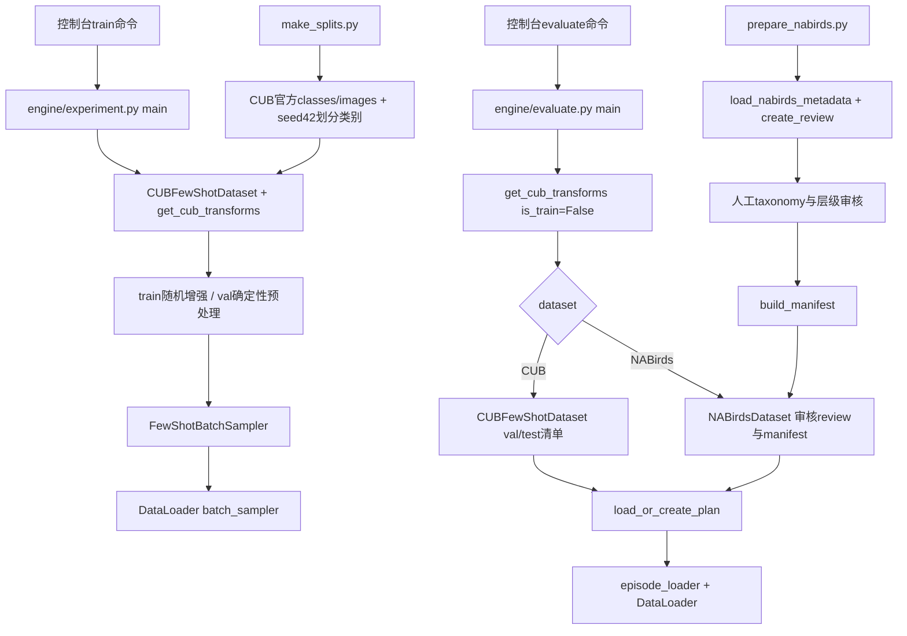

上图是源码调用关系，不表示本阶段运行了train/evaluate。实际只直接实例化数据组件。

| 位置 | 职责 |
|---|---|
| `src/pattern_recognition_coursework/data/cub_dataset.py:10–32` | 训练与评估Transform |
| 同文件`:35–96` | CUB清单、类别映射、RGB读取及transform |
| 同文件`:99–156` | episode抽样、固定种子、support/query索引顺序 |
| `data/episodes.py:10–72` | 有序清单指纹、任务验证和持久化 |
| `data/nabirds.py:65–96` | 图像索引、标签、层级与安全路径 |
| 同文件`:99–202` | 生成待审核项、人工结论验证、物种级manifest |
| 同文件`:205–282` | 正式NABirdsDataset及RGB读取 |
| `scripts/make_splits.py:29–94` | 原始CUB类列表以seed42打乱，100/50/50类拆分并输出图片清单 |
| `scripts/validate_cub.py:24–71` | 清单和官方元信息一致性、类别/图片ID互斥 |
| `scripts/prepare_nabirds.py:13–38` | 审核模板与正式清单CLI |
| `engine/experiment.py:231–234,308–310` | train/val Dataset与训练DataLoader构造 |
| 同文件`:93–94,128–136` | 固定评估episode的DataLoader；监督路径普通shuffle DataLoader |
| `engine/evaluate.py:62–86` | 测试只用eval Transform，CUB/NABirds Dataset后固定计划 |

本阶段真实数据根是`cub2002011/versions/7/CUB_200_2011`及`nabirds`，入口默认`data/raw/...`当前不存在；诊断显式指定根，不移动数据。`make_splits.find_cub_root`的递归兜底可能识别到NABirds同名元信息，因此本阶段不调用会重写清单的生成脚本，仅在内存重现seed划分并与当前文件比较。

## 4. 实际Transform及顺序（本机torchvision实例）

### 训练路径

1. PIL读取后`convert('RGB')`，确保三通道。
2. `RandomResizedCrop(224, scale=(0.2,1.0), ratio=(0.75,4/3), interpolation=BILINEAR, antialias=True)`：随机选择占原图20%–100%面积、宽高比0.75–1.3333的矩形，再缩放成224×224。比例与面积不等同于边长比例；实现尝试最多10次，失败按默认中心区域回退。此步内部包含resize，训练前**没有额外Resize**。
3. `RandomHorizontalFlip(p=0.5)`：以50%概率左右翻转；没有垂直翻转。
4. `ColorJitter(brightness=0.15, contrast=0.15, saturation=0.15)`：亮度/对比度/饱和度因子分别在[0.85,1.15]采样，三者应用顺序随机；`hue=None`，没有色相扰动。
5. `ToTensor()`：uint8 RGB HWC转换为float32 CHW，像素缩放至[0,1]。
6. `Normalize(mean=[0.485,0.456,0.406], std=[0.229,0.224,0.225])`：逐通道`(x-mean)/std`，空间尺寸不变，值不再限于[0,1]。对于原始[0,1]，三通道理论范围分别约[-2.118,2.249]、[-2.036,2.429]、[-1.804,2.640]。

### 验证及测试路径（CUB与NABirds共用）

1. RGB转换。
2. `Resize(int(224*1.15))`，Python截断结果是**257**，不是258。整数size表示将短边缩放至257并保持宽高比，BILINEAR、antialias=True，max_size=None；不是直接拉伸成257×257。
3. `CenterCrop(224)`得到224×224。
4. `ToTensor()`，随后同样的`Normalize`。

**测试路径没有随机裁剪、Flip或ColorJitter。** 对所选同一图片改变seed重复执行eval Transform，张量逐元素相等。没有发现代码实际使用RandomRotation、RandomErasing、AutoAugment、MixUp、CutMix或边界框裁剪，不能把这些写成现有增强。

完整实例repr和默认参数见 [transforms.json](transforms.json)。参数适用于本次224像素检查；其他image_size会改变Resize与crop大小。归一化反操作是`x=tensor*std+mean`，本次图片均先反归一化，再仅在显示边界clamp至[0,1]；原始副本逐字节保留。

## 5. 数据泄漏及划分检查

- 类别、图像ID与路径交集：`{'train_val': {'class_names': 0, 'image_ids': 0, 'paths': 0}, 'train_test': {'class_names': 0, 'image_ids': 0, 'paths': 0}, 'val_test': {'class_names': 0, 'image_ids': 0, 'paths': 0}}`。
- seed42类别划分与当前三份类清单一致：`{'train': True, 'val': True, 'test': True}`。
- 对全部 **60350** 个索引文件执行SHA256，共 **60349** 种字节内容；跨CUB划分重复组 **0**；CUB↔NABirds精确重复组 **0**。见 [content_audit.json](evidence/content_audit.json) 和完整 [image_sha256.csv](evidence/image_sha256.csv)。
- support/query内容隔离：**FAIL**。CUB test新采样任务零基`200`出现不同索引相同字节分别在support/query，seed42，5-way 5-shot，每类5 query。原采样器仅保证索引不重复，本阶段未修复，也未重写历史结果。
- 精确哈希不排除裁剪/压缩版本、近重复、背景/拍摄来源关联或ImageNet预训练重叠。本阶段不把“0个精确重复”宣称完全无泄漏。
- 名称与祖先匹配只是物种重叠候选。当前NABirds review缺失，不能确认源/目标物种独立性；正式工具默认只排CUB train，若要求排除全部CUB需明确协议。
- CUB使用项目类别级100/50/50划分，不采用官方train_test_split.txt图像级5994/5794作为本课题划分。官方图像级标记可能与项目split不同，不是自动泄漏证据。

名称/祖先重叠候选明细见 [species_overlap_candidates.csv](statistics/species_overlap_candidates.csv)。350条是三个CUB划分全部匹配记录，祖先链可能为同一视觉类产生多条记录，不能当作350个重叠物种：

| CUB来源 | 匹配记录条数 | 不同NABirds视觉类 | 不同CUB类别 |
|---|---:|---:|---:|
| train | 144 | 72 | 58 |
| val | 114 | 57 | 34 |
| test | 92 | 46 | 30 |

这些是当前元信息名称匹配结果，不是专家确认的物种数量；同物异名可能漏检。待审核模板已保存在`evidence/nabirds_pending_review_DIAGNOSTIC_ONLY.json`，所有decision保持pending，不是正式test manifest。

## 6. 同批数据Tensor证据

每组下面的4个样本与可视化选择完全相同。train用实际训练Transform；val/NABirds原始诊断用实际eval Transform。不同数据集本地整数标签属于不同命名空间，不把三组拼成共享分类训练batch。

### cub_train

```json
{
  "images": {
    "shape": [
      4,
      3,
      224,
      224
    ],
    "dtype": "torch.float32",
    "min": -1.9131652116775513,
    "max": 2.640000104904175,
    "finite": true
  },
  "labels": [
    29,
    29,
    88,
    56
  ],
  "labels_dtype": "torch.int64",
  "labels_shape": [
    4
  ],
  "class_names": [
    "062.Herring_Gull",
    "062.Herring_Gull",
    "176.Prairie_Warbler",
    "114.Black_throated_Sparrow"
  ],
  "paths": [
    "cub2002011/versions/7/CUB_200_2011/images/062.Herring_Gull/Herring_Gull_0145_46220.jpg",
    "cub2002011/versions/7/CUB_200_2011/images/062.Herring_Gull/Herring_Gull_0139_47006.jpg",
    "cub2002011/versions/7/CUB_200_2011/images/176.Prairie_Warbler/Prairie_Warbler_0002_172622.jpg",
    "cub2002011/versions/7/CUB_200_2011/images/114.Black_throated_Sparrow/Black_Throated_Sparrow_0026_107198.jpg"
  ],
  "actual_transform": "train",
  "label_namespace": "cub_train_local"
}
```

### cub_val

```json
{
  "images": {
    "shape": [
      4,
      3,
      224,
      224
    ],
    "dtype": "torch.float32",
    "min": -2.1179039478302,
    "max": 2.640000104904175,
    "finite": true
  },
  "labels": [
    10,
    1,
    16,
    14
  ],
  "labels_dtype": "torch.int64",
  "labels_shape": [
    4
  ],
  "class_names": [
    "049.Boat_tailed_Grackle",
    "010.Red_winged_Blackbird",
    "076.Dark_eyed_Junco",
    "069.Rufous_Hummingbird"
  ],
  "paths": [
    "cub2002011/versions/7/CUB_200_2011/images/049.Boat_tailed_Grackle/Boat_Tailed_Grackle_0123_33695.jpg",
    "cub2002011/versions/7/CUB_200_2011/images/010.Red_winged_Blackbird/Red_Winged_Blackbird_0105_4842.jpg",
    "cub2002011/versions/7/CUB_200_2011/images/076.Dark_eyed_Junco/Dark_Eyed_Junco_0131_66423.jpg",
    "cub2002011/versions/7/CUB_200_2011/images/069.Rufous_Hummingbird/Rufous_Hummingbird_0065_58497.jpg"
  ],
  "actual_transform": "eval",
  "label_namespace": "cub_val_local"
}
```

### nabirds_raw

```json
{
  "images": {
    "shape": [
      4,
      3,
      224,
      224
    ],
    "dtype": "torch.float32",
    "min": -2.1179039478302,
    "max": 2.640000104904175,
    "finite": true
  },
  "labels": [
    120,
    109,
    448,
    11
  ],
  "labels_dtype": "torch.int64",
  "labels_shape": [
    4
  ],
  "class_names": [
    "Great Blue Heron",
    "Wild Turkey",
    "Swamp Sparrow",
    "Cinnamon Teal (Male)"
  ],
  "paths": [
    "nabirds/images/0480/e259f772624446cc8a040d1f2fbce885.jpg",
    "nabirds/images/0469/46efdba618b040109f78d9437d2938e6.jpg",
    "nabirds/images/0904/7649d722580f44788383404129e4a61d.jpg",
    "nabirds/images/0319/19e3437a32a54f0789879a26732ebc85.jpg"
  ],
  "actual_transform": "eval",
  "label_namespace": "raw_visual_category"
}
```

### cub_train_episode_1shot

```json
{
  "images": {
    "shape": [
      30,
      3,
      224,
      224
    ],
    "dtype": "torch.float32",
    "min": -2.1179039478302,
    "max": 2.640000104904175,
    "finite": true
  },
  "dataset_labels": [
    81,
    14,
    3,
    94,
    35,
    81,
    81,
    81,
    81,
    81,
    14,
    14,
    14,
    14,
    14,
    3,
    3,
    3,
    3,
    3,
    94,
    94,
    94,
    94,
    94,
    35,
    35,
    35,
    35,
    35
  ],
  "class_order": [
    81,
    14,
    3,
    94,
    35
  ],
  "query_episode_labels": [
    0,
    0,
    0,
    0,
    0,
    1,
    1,
    1,
    1,
    1,
    2,
    2,
    2,
    2,
    2,
    3,
    3,
    3,
    3,
    3,
    4,
    4,
    4,
    4,
    4
  ],
  "support_count": 5,
  "query_count": 25,
  "labels_dtype": "torch.int64"
}
```

### cub_train_episode_5shot

```json
{
  "images": {
    "shape": [
      50,
      3,
      224,
      224
    ],
    "dtype": "torch.float32",
    "min": -2.1179039478302,
    "max": 2.640000104904175,
    "finite": true
  },
  "dataset_labels": [
    81,
    81,
    81,
    81,
    81,
    14,
    14,
    14,
    14,
    14,
    3,
    3,
    3,
    3,
    3,
    94,
    94,
    94,
    94,
    94,
    35,
    35,
    35,
    35,
    35,
    81,
    81,
    81,
    81,
    81,
    14,
    14,
    14,
    14,
    14,
    3,
    3,
    3,
    3,
    3,
    94,
    94,
    94,
    94,
    94,
    35,
    35,
    35,
    35,
    35
  ],
  "class_order": [
    81,
    14,
    3,
    94,
    35
  ],
  "query_episode_labels": [
    0,
    0,
    0,
    0,
    0,
    1,
    1,
    1,
    1,
    1,
    2,
    2,
    2,
    2,
    2,
    3,
    3,
    3,
    3,
    3,
    4,
    4,
    4,
    4,
    4
  ],
  "support_count": 25,
  "query_count": 25,
  "labels_dtype": "torch.int64"
}
```

## 7. 至少10张原始与增强对照（实际12张）

每行左到右为：原图、三次独立训练增强、确定性eval预处理。图内注明类别、路径和增强类型。`cub_val`与`nabirds_raw`的训练增强列是**反事实展示**，不是实际验证/测试输入；实际DataLoader使用eval列。原图展示适配画布的padding只用于排版，不是项目Transform。

[完整总览](visualizations/contact_sheet.png)；样本索引、原图副本SHA256、增强seed、各张量范围见 [sample_manifest.json](sample_manifest.json)。

### 01 — cub_train — 062.Herring_Gull

`cub2002011/versions/7/CUB_200_2011/images/062.Herring_Gull/Herring_Gull_0145_46220.jpg`；label=29；原始尺寸=[500, 375]。

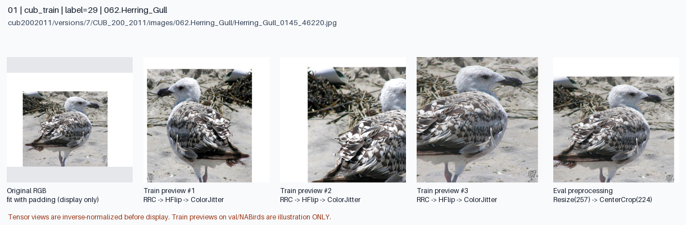

[逐字节原图副本](samples/01_cub_train_1723/original.jpg)

### 02 — cub_train — 062.Herring_Gull

`cub2002011/versions/7/CUB_200_2011/images/062.Herring_Gull/Herring_Gull_0139_47006.jpg`；label=29；原始尺寸=[500, 375]。

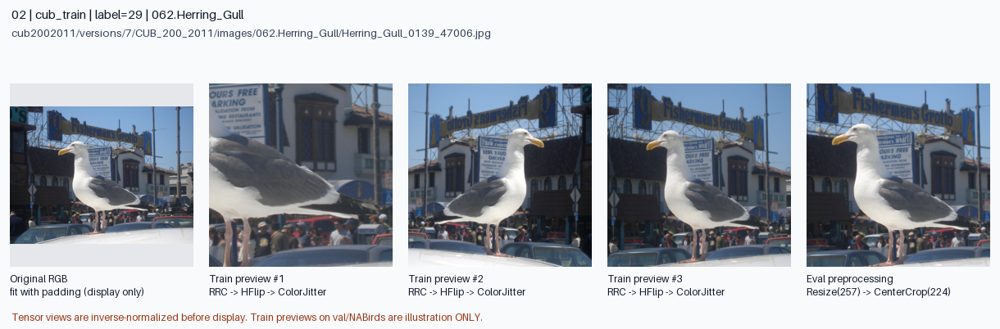

[逐字节原图副本](samples/02_cub_train_1752/original.jpg)

### 03 — cub_train — 176.Prairie_Warbler

`cub2002011/versions/7/CUB_200_2011/images/176.Prairie_Warbler/Prairie_Warbler_0002_172622.jpg`；label=88；原始尺寸=[500, 328]。

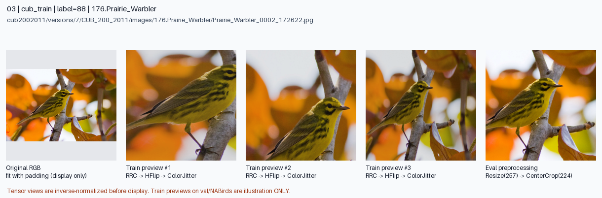

[逐字节原图副本](samples/03_cub_train_5205/original.jpg)

### 04 — cub_train — 114.Black_throated_Sparrow

`cub2002011/versions/7/CUB_200_2011/images/114.Black_throated_Sparrow/Black_Throated_Sparrow_0026_107198.jpg`；label=56；原始尺寸=[300, 274]。

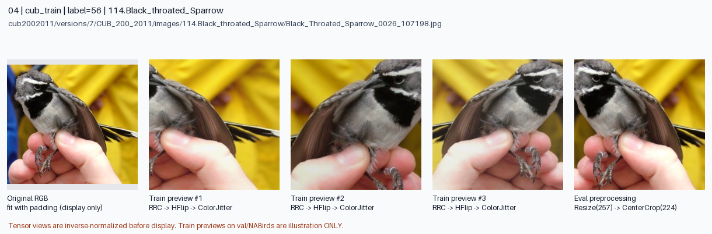

[逐字节原图副本](samples/04_cub_train_3313/original.jpg)

### 05 — cub_val — 049.Boat_tailed_Grackle

`cub2002011/versions/7/CUB_200_2011/images/049.Boat_tailed_Grackle/Boat_Tailed_Grackle_0123_33695.jpg`；label=10；原始尺寸=[500, 333]。

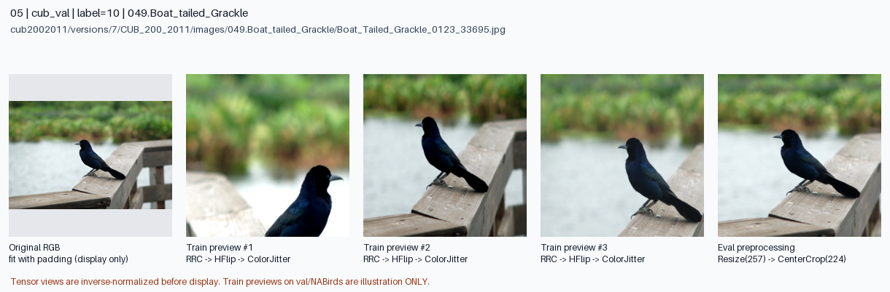

[逐字节原图副本](samples/05_cub_val_596/original.jpg)

### 06 — cub_val — 010.Red_winged_Blackbird

`cub2002011/versions/7/CUB_200_2011/images/010.Red_winged_Blackbird/Red_Winged_Blackbird_0105_4842.jpg`；label=1；原始尺寸=[500, 406]。

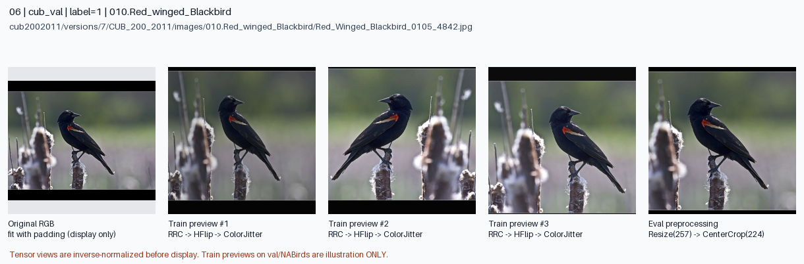

[逐字节原图副本](samples/06_cub_val_99/original.jpg)

### 07 — cub_val — 076.Dark_eyed_Junco

`cub2002011/versions/7/CUB_200_2011/images/076.Dark_eyed_Junco/Dark_Eyed_Junco_0131_66423.jpg`；label=16；原始尺寸=[500, 375]。

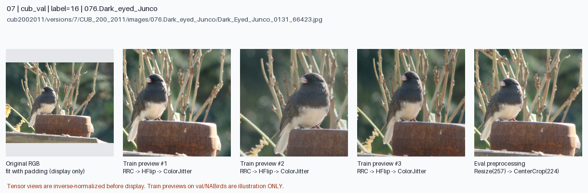

[逐字节原图副本](samples/07_cub_val_959/original.jpg)

### 08 — cub_val — 069.Rufous_Hummingbird

`cub2002011/versions/7/CUB_200_2011/images/069.Rufous_Hummingbird/Rufous_Hummingbird_0065_58497.jpg`；label=14；原始尺寸=[500, 333]。

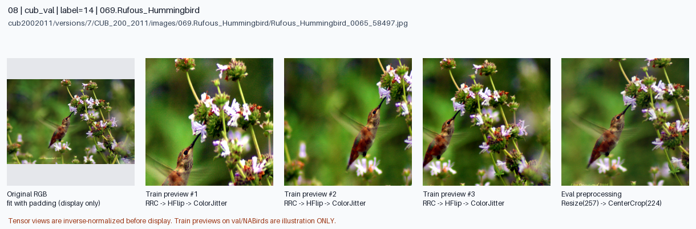

[逐字节原图副本](samples/08_cub_val_828/original.jpg)

### 09 — nabirds_raw — Great Blue Heron

`nabirds/images/0480/e259f772624446cc8a040d1f2fbce885.jpg`；label=120；原始尺寸=[819, 1024]。

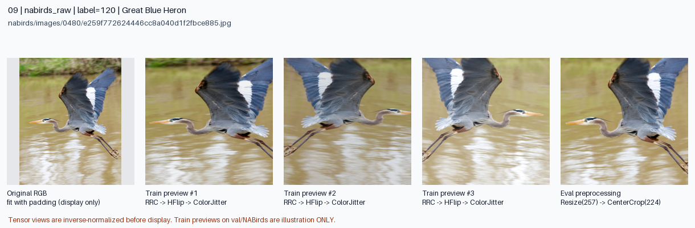

[逐字节原图副本](samples/09_nabirds_raw_43000/original.jpg)

### 10 — nabirds_raw — Wild Turkey

`nabirds/images/0469/46efdba618b040109f78d9437d2938e6.jpg`；label=109；原始尺寸=[1024, 768]。

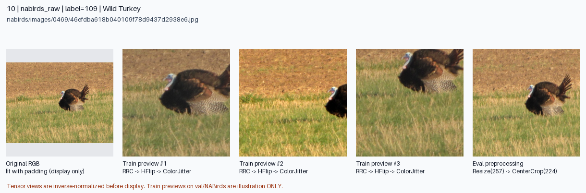

[逐字节原图副本](samples/10_nabirds_raw_13353/original.jpg)

### 11 — nabirds_raw — Swamp Sparrow

`nabirds/images/0904/7649d722580f44788383404129e4a61d.jpg`；label=448；原始尺寸=[1024, 684]。

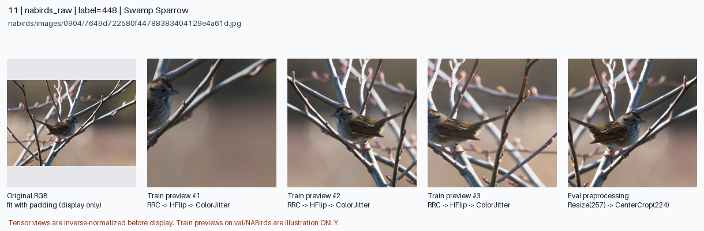

[逐字节原图副本](samples/11_nabirds_raw_22471/original.jpg)

### 12 — nabirds_raw — Cinnamon Teal (Male)

`nabirds/images/0319/19e3437a32a54f0789879a26732ebc85.jpg`；label=11；原始尺寸=[1024, 670]。

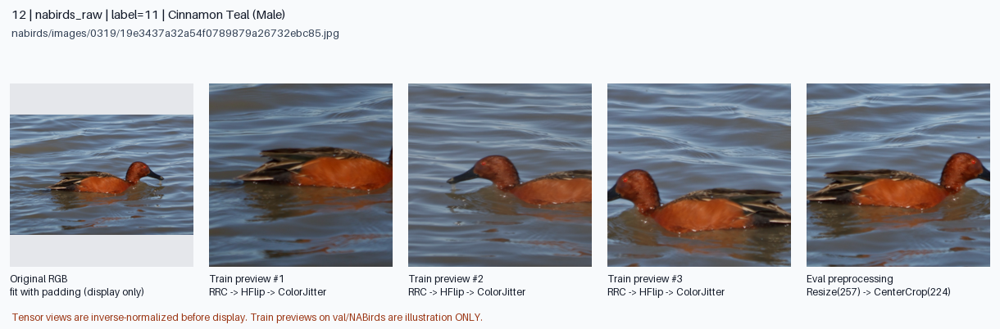

[逐字节原图副本](samples/12_nabirds_raw_4878/original.jpg)

## 8. 自动化测试、复现与范围

测试脚本：[test_data_checks.py](test_data_checks.py)。执行日志及JUnit逐用例保存在evidence。数据诊断使用CPU和num_workers=0，未下载任何数据或权重，未创建模型、optimizer或调用项目engine。

```bash
PYTHONDONTWRITEBYTECODE=1 PYTHONPATH=src:outputs/stage01_data .venv/bin/python -B -m pytest outputs/stage01_data/test_data_checks.py tests/test_data_pipeline.py tests/test_episode_plan_and_nabirds.py -q -p no:cacheprovider -o addopts='' --basetemp=outputs/stage01_data/evidence/pytest_tmp --junitxml=outputs/stage01_data/evidence/junit.xml
```

本轮已实际执行该组测试；若重跑请为basetemp/JUnit选择新的证据目录，以免pytest清理已有临时目录。`test_data_checks.py`中的内容级互斥与正式审核清单验收故意是正常断言，已知未通过项不会通过xfail/skip掩盖；应阅读实际测试结果，而不是要求一律绿色。合成NABirds审核测试仅验证正式Dataset机械逻辑，绝不表示真实物种已人工确认。

`check_data.py`可生成全套证据，默认拒绝覆盖已有statistics；`--report-only`仅由已生成证据重新渲染本报告。完整源码、数据清单前后保全结果见 [preservation.json](evidence/preservation.json)。停留在Stage01，等待用户确认后再开展下一阶段。

## 第一阶段后续：逻辑去重

[全量重复审计、清洗索引及28项通过测试](cub_dedup/report.md)。本报告原始索引的失败记录保留；清洗索引在独立目录中通过内容互斥验证，NABirds物种审核阻塞仍存在。
