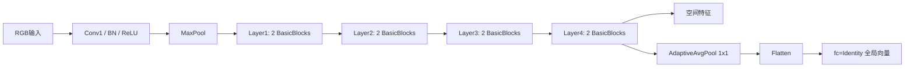

> 最新更新：[历史ImageNet自定义加载兼容修复](loader_compatibility/report.md)已完成，15项测试通过，完整编码器及真实图片输出与torchvision精确一致。下面保留此前阶段记录。

> 后续更新：用户已提供真实权重，两种权重均完成实际前向验证；ImageNet本地严格导入存在BN计数器兼容问题。详见[权重补充验证](weights_verification/report.md)。下文保留原检查时缺权重的历史状态。

# 第二阶段：ResNet-18 Backbone、初始化与特征提取验证

## 验收结论

**部分通过，不能宣称三种真实初始化全部验证完成。** Random已在真实同批鸟类图片上前向通过；ImageNet Supervised和SimCLR缺本地权重，未下载、未伪装为成功。共9项可执行断言检查通过。未训练、未创建optimizer、未修改网络/训练/分类/划分代码。

重复内容计算和逻辑去重归属于第一阶段，结果已迁移到`outputs/stage01_data/cub_dedup/`。清洗索引仍为`data/splits/cub_clean_v1/`，未修改内容。第一阶段清洗CUB内容互斥已验证，但NABirds正式物种审核仍阻塞，不把第一阶段描述为所有研究条件均已通过。

## 定义与实际调用

| 位置 | 职责 |
|---|---|
| `src/pattern_recognition_coursework/models/backbones/resnet.py:85–109 make_backbone` | 项目构造入口；调用torchvision.models.resnet18(weights=...)，将fc替换为Identity |
| 同文件`:14–81 load_backbone_weights` | 本地权重严格导入，完整键及shape验证；可明确选择前缀，成对排除分类头 |
| 同文件`:112–117 spatial_features` | 手动前向至layer4，保留空间维度 |
| `models/few_shot.py:62` | FewShotModel初始化时调用make_backbone |
| 同文件`:90–102 encode` | dn4/global_local调用spatial_features；其余调用backbone得到全局向量；可选adapter随后作用 |
| `engine/experiment.py:240–245` | CLI初始化参数传入FewShotModel；此路径本轮只读，不启动训练 |
| `engine/experiment.py:57–63`、`engine/evaluate.py:49–53` | 重建评估模型时关闭外部初始化，再严格加载完整训练checkpoint；不能把这个临时随机构造误判为最终随机评估 |
| `scripts/convert_simclr_resnet18.py:33–57,60–87` | Lightning序列编码器转换、源SHA256验证与导出；本轮仅抽取原转换函数用于合成接口测试，没有启动训练入口 |

具体BasicBlock和初始化逻辑来自当前安装torchvision的`models/resnet.py`，不是项目重新手写的ResNet。完整实例结构见[network.txt](network.txt)。架构为每个stage各2个BasicBlock，每块2个3×3卷积，残差相加；stage2/3/4第一块使用stride2及1×1下采样shortcut匹配维度。Conv1为7×7、stride2、padding3、64通道，随后BN和ReLU、3×3 stride2 maxpool。卷积按torchvision默认Kaiming normal初始化，BN缩放/偏置默认1/0；`weights=None`不代表所有权重为零。



## 实际输入与Tensor Shape

使用第一阶段抽到的同4张CUB验证图片，清洗索引中验证集顺序与标签未改变。Dataset使用确定性Resize(257)→CenterCrop(224)→ToTensor→ImageNet Normalize。实际样本路径、标签和输入统计见[evidence/input_batch.json](evidence/input_batch.json)。所有前向在CPU、eval及inference_mode执行。未更新BN统计，前后整个state_dict指纹一致。

| 阶段 | 224×224输入的实际Shape（B=4） |
|---|---|
| input | `[4, 3, 224, 224]` |
| conv1 | `[4, 64, 112, 112]` |
| bn1 | `[4, 64, 112, 112]` |
| relu | `[4, 64, 112, 112]` |
| maxpool | `[4, 64, 56, 56]` |
| layer1 | `[4, 64, 56, 56]` |
| layer2 | `[4, 128, 28, 28]` |
| layer3 | `[4, 256, 14, 14]` |
| layer4 | `[4, 512, 7, 7]` |
| avgpool | `[4, 512, 1, 1]` |
| fc | `[4, 512]` |

因此预期空间特征`[B,512,7,7]`与全局`[B,512]`均成立。`spatial_features(...).mean((-1,-2))`与直接backbone输出逐元素近似相等（torch.testing.assert_close通过），没有额外1000类分类输出。

| 其他检查尺寸 | 空间特征 | 全局向量 |
|---|---|---|
| 84×84 | `[4, 512, 3, 3]` | `[4, 512]` |
| 64×64 | `[4, 512, 2, 2]` | `[4, 512]` |

224是入口默认；README小显存示例使用84，原合成训练测试使用64。本轮额外尺寸由同一批224张量双线性缩放得到，只验证网络尺寸兼容，不冒称这就是各分辨率的完整数据预处理或可比成绩。

## 三种初始化与真实权重证据

| 初始化 | 实现 | 实际加载/前向 | 参数及可训练参数 |
|---|---|---|---|
| Random | weights=None | VERIFIED | 11,176,512 / 11,176,512 |
| ImageNet Supervised | 权重接口存在 | BLOCKED_MISSING_WEIGHTS | 11,176,512 / 11,176,512 |
| SimCLR | 权重接口存在 | BLOCKED_MISSING_WEIGHTS | 11,176,512 / 11,176,512 |

后三种计数属于同一骨干架构；缺权重项没有实例化相应的真实预训练模型，不能把结构计数当加载证据。eval/inference_mode不改变requires_grad，默认骨干参数仍全部标为可训练，但本轮不求梯度、不优化。

### Random

测试拦截torch.load和URL加载器，随机构造过程不得调用两者；监测构造函数确实收到`weights=None`，backbone_load_info=None。同seed42构造的全部state_dict指纹一致，seed43不同。真实图片特征有限、整体方差非零、不同图片向量不同。随机特征能前向不证明具备分类能力。

### ImageNet Supervised

项目指定`ResNet18_Weights.IMAGENET1K_V1`，官方权重URL为`https://download.pytorch.org/models/resnet18-f37072fd.pth`。未找到项目`data/cache/torch/checkpoints/`及torch默认hub缓存中的目标文件；发现的ResNet-34缓存不是ResNet-18，不能替代。**真实加载、缺失/多余参数列表与真实特征均无法验证，记录为null而非空列表成功。** 本轮未调用可能自动下载的pretrained=True构造路径。

原生torchvision路径在移除fc前加载完整1000类权重；项目本地加载路径在移除fc后严格匹配编码器，可显式丢弃完整fc.weight与fc.bias。加载器支持“文件架构匹配”，并不能单凭一个任意本地文件就认证其ImageNet来源。完整官方权重身份仍需核验文件哈希与可信来源。

### SimCLR

现有provenance声明来源`https://huggingface.co/DM-Diaz/SimCLR-ResNet18-ImageNet1K`，训练数据声明为ImageNet-1K，源文件`checkpoint_100-resnet18-simclr-imagenet1k.ckpt`，epoch99、120个编码器state条目。它是仓库历史声明，本轮没有权重或外部训练记录可独立验证。具体源/输出SHA256与搜索路径完整保存在[initializations.json](initializations.json)。

转换关系：`backbone.0→conv1`、`.1→bn1`、`.4/.5/.6/.7→layer1/2/3/4`。仅收集backbone前缀，检查完整键、shape和dtype；非backbone投影头不进入编码器，后续只使用512维编码器特征，不使用对比学习投影向量。未知backbone编号会拒绝，不猜前缀。

**源ckpt和导出encoder文件均缺失**，不能实际核对投影头、真实参数或执行SimCLR前向；也无法确认历史具体文件没有被错误标记。没有用Random、ImageNet或合成文件冒充SimCLR。将来需要提供与记录哈希匹配的原文件，或另行保存可审计的新来源记录。

## 特征统计

只有Random存在真实特征；其余两组为“未测”，不填模拟数值。

```json
{
  "Random": {
    "spatial": {
      "shape": [
        4,
        512,
        7,
        7
      ],
      "dtype": "torch.float32",
      "finite": true,
      "min": 0.0,
      "max": 9.86975383758545,
      "mean": 0.7536091804504395,
      "std": 1.0470753908157349,
      "nonzero_fraction": 0.6170579791069031
    },
    "global": {
      "shape": [
        4,
        512
      ],
      "dtype": "torch.float32",
      "finite": true,
      "min": 0.0,
      "max": 4.2392401695251465,
      "mean": 0.7536091208457947,
      "std": 0.7641700506210327,
      "nonzero_fraction": 0.98876953125
    },
    "different_image_max_abs_difference": 1.1353304386138916
  }
}
```

未把随机响应或卷积通道解释为鸟嘴、眼睛、翅膀等具体器官。本轮无需用特征图可视化替代数值验证。

## 可执行测试及证据边界

- **PASS** `random_never_loads_pretraining`
- **PASS** `random_seed_reproducibility`
- **PASS** `224_shapes_finite_nonconstant_and_gap_equivalence`
- **PASS** `synthetic_local_loader_roundtrip_NOT_pretrained`
- **PASS** `reject_missing_encoder_key`
- **PASS** `reject_unexpected_key`
- **PASS** `reject_wrong_shape`
- **PASS** `explicit_classifier_head_exclusion_synthetic`
- **PASS** `simclr_key_translation_SYNTHETIC_ONLY`

合成加载测试实际将Random state_dict保存再读回，逐参数指纹一致；缺key、多余key、错误shape分别拒绝；完整模拟分类头明确排除。SimCLR键转换使用合成顺序编码器及投影头验证120条编码器映射、投影排除、缺键拒绝。这些只验证加载器/转换器机械正确性，**不是任何真实预训练来源的证明**。文件`evidence/synthetic_random_encoder.pt`明确为合成随机测试权重，不能用于填充缺失预训练组。

[evidence/tests.json](evidence/tests.json)保存逐项状态，[evidence/run.log](evidence/run.log)为原始日志，[evidence/preservation.json](evidence/preservation.json)记录本次源码与划分保全。运行脚本为[check_backbone.py](check_backbone.py)。没有运行训练、没有网络下载、没有修改模型或其他实验模块；唯一配套组织变更是将上一任务哈希审计目录迁入第一阶段及更新其脚本默认报告路径。

```bash
PYTHONDONTWRITEBYTECODE=1 PYTHONPATH=src OMP_NUM_THREADS=2 MKL_NUM_THREADS=2 .venv/bin/python -B outputs/stage02_backbone/check_backbone.py
```

若重跑请选择独立输出目录或先另存这份证据，避免覆盖本轮合成fixture和JSON。当前两个预训练组阻塞，需要用户提供本地真实权重后补验证；不自动下载、不进入完整训练。`outputs/`按现有Git规则被忽略，文件实际存在，但尚未提交到Git。
