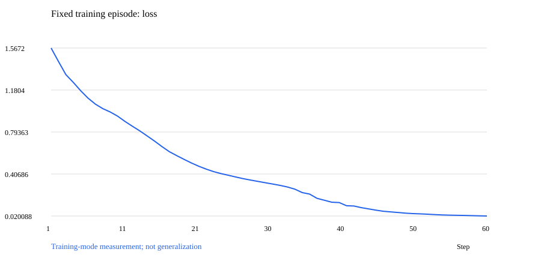
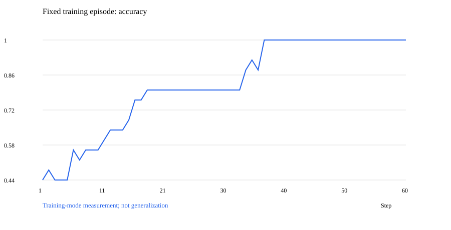
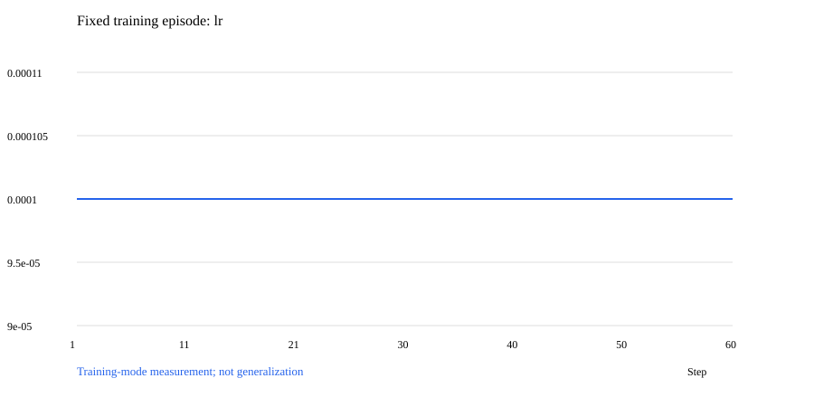
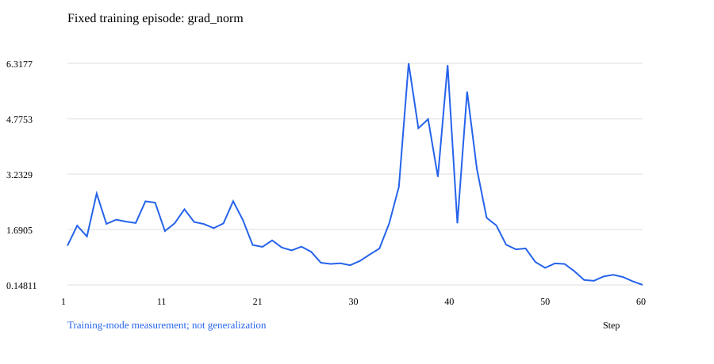
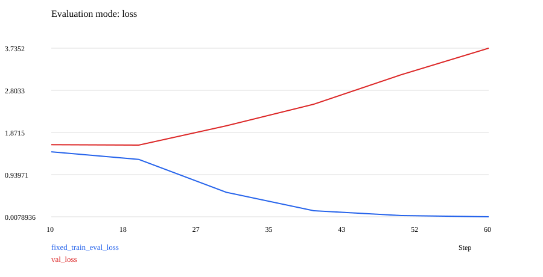
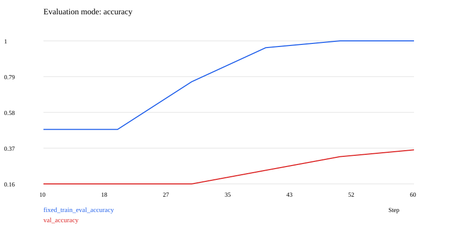
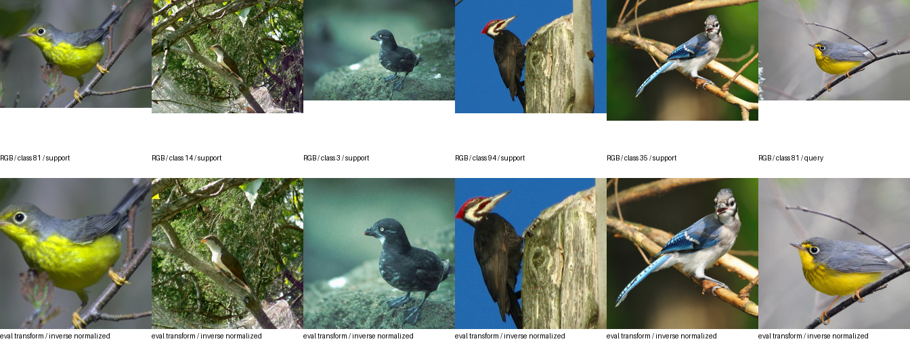

# Stage 03：真实CUB小规模训练与训练流程验证

## 1. 结论与范围

**第三阶段通过：代码可执行、参数确实更新、固定样本具有过拟合能力。可以进入受控的正式源域Baseline训练准备。** 该结论不证明泛化能力、NABirds物种审核完成或完整研究目标达成。不能把本阶段训练准确率写成测试成绩；未启动正式全量训练。

全部只用清洗后的CUB train训练；独立CUB val固定episode只做验证，不参与反传或checkpoint选择；没有读取CUB test或NABirds图片。源码与清洗划分前后哈希一致。记录于[保全证据](evidence/preservation.json)。

## 2. 项目入口、Loss与复用方式

- 控制台入口`src/pattern_recognition_coursework/__init__.py:4`分派train到`engine/experiment.py:200`。
- episodic循环`:302–317`使用`FewShotBatchSampler`和DataLoader；`:97–125 run_episodes`执行model→F.cross_entropy→zero_grad/backward/Adam.step，并算episode指标。本阶段直接复用这个函数，没有另写分类器或替换Loss。
- `models/few_shot.py:83–138`调用ResNet-18编码support/query，按support类别均值得原型；`models/metrics/episode.py:18`计算负平方欧氏距离除以512作为logits。本配置温度固定1；query临时标签按support顺序映射0..4，交叉熵等价于-softmax真实类别的log概率。
- 另有`supervised_epoch:128–148`：GAP512维特征→基础类线性分类头→全局基础类别CrossEntropy。`stage=supervised`做监督训练；`meta_baseline`先监督再episodic。此阶段选择正式已实现的ProtoNet路径，不切换到监督分类以制造过拟合成功。
- 原入口使用Adam，没有Scheduler，也未发现TensorBoard集成；episodic history主要保存accuracy，best.pt没有optimizer/RNG。这一阶段在**独立诊断脚本**外围增加CSV、SummaryWriter和完整诊断checkpoint，不修改正式训练入口。
- Dataset、Sampler、内容去重及Transform沿用前两阶段；`require_clean_index=True`，图片清单及每张image ID/原始dataset label/episode label保存在[input_samples.json](evidence/input_samples.json)。

## 3. 实验配置及环境

CPU运行，Random seed42，全量骨干可训练，224×224，5-way 1-shot、每类5 query（项目CLI默认），每episode共30张图，5 support+25 query。Adam lr=1e-4，不加scheduler或梯度裁剪，不加载外部权重。

- 单Batch前后向1 Step。
- Smoke Test 3 Step：在单Batch模型/optimizer后继续，用同训练索引、现有随机训练增强，检测真实增强输入流程。
- 冻结范围探针1 Step：另建Random模型，沿用现有configure_trainable_scope(layer4)，验证冻结conv1～layer3不更新、整个骨干BN buffer不更新。
- 固定样本Overfit 60 Step：重新Random seed42模型和Adam，重复同一个训练episode。使用已有eval Transform关闭随机增强；此预处理选择仅作诊断，不修改正式增强协议。
- 总optimizer更新严格上限65，实际65。独立验证每10个overfit step一次；诊断把每10步视为一个epoch，共6次，不改变正式训练的epoch预算。
- Overfit预设通过标准：**固定训练episode在eval模式准确率≥95%，且loss相对初始下降≥30%**，不是观察结果后改阈值。

完整参数：[config.json](config.json)；环境：[environment.json](environment.json)。采用CPU，跳过GPU显存指标，TensorBoard没有伪造system/gpu_memory_mb。

## 4. 单Batch前向、梯度及参数更新

输入float32 `[30,3,224,224]`；Dataset返回30个int64原split标签，实际Loss使用25个int64临时query标签。Backbone `[30,512]`，support `[5,512]`、query `[25,512]`，prototype `[5,512]`，query logits `[25,5]`。全部有限。

单Batch证据包含真实输入范围、每类原型完整512维数值、原始平方距离和模型分数（负距离/512）、真实query标签与预测、交叉熵；见[single_batch.json](evidence/single_batch.json)。

参数更新范数是**本次optimizer.step紧邻前后全部named_parameters的L2差值**；每层也分别记录。全局梯度范数是所有实际梯度L2平方和开根号，不用不相邻快照冒充单步更新。

| 关键层 | 单Batch梯度L2 | 单Batch参数更新L2 |
|---|---:|---:|
| conv1 | 1.05331 | 0.00969938 |
| layer1 | 0.436396 | 0.038463 |
| layer2 | 0.33326 | 0.0724763 |
| layer3 | 0.268604 | 0.14487 |
| layer4 | 0.223949 | 0.289538 |

全量训练各层梯度存在、有限、非零，且参数实际变化。独立layer4探针的conv1～layer3无梯度且参数差严格0，layer4有梯度和更新，所有BN缓冲区前后一致。逐Step详见[gradients.json](evidence/gradients.json)及[parameter_updates.json](evidence/parameter_updates.json)。

## 5. 固定Episode过拟合结果

| 测量 | 初始eval | 第60步后eval |
|---|---:|---:|
| loss | 1.54618854 | 0.00789356 |
| accuracy | 0.20000000 | 1.00000000 |

按预设标准：**PASS**。最后训练态loss=0.02008833、accuracy=100.00%；训练态与eval模式受BatchNorm影响，不能混为同一测量。

60个overfit step的全局梯度范数范围[0.148107, 6.31767]，所有梯度与Loss有限。个别波动不被武断判为错误；当前有整体下降、参数更新和最终拟合共同支持可学习性。

独立验证只取一个固定5-way任务，25个query；每10步重复，不是多seed统计，也不足以支持泛化结论。验证不用于选超参数或最佳模型。

| Step | 固定Train eval loss | Train eval accuracy | 独立val loss | val accuracy |
|---|---:|---:|---:|---:|
| 10 | 1.444156 | 48.00% | 1.601383 | 16.00% |
| 20 | 1.276134 | 48.00% | 1.592658 | 16.00% |
| 30 | 0.549247 | 76.00% | 2.018860 | 16.00% |
| 40 | 0.141566 | 96.00% | 2.496276 | 24.00% |
| 50 | 0.034577 | 100.00% | 3.148399 | 32.00% |
| 60 | 0.007894 | 100.00% | 3.735156 | 36.00% |

## 6. TensorBoard与曲线

使用torch.utils.tensorboard.SummaryWriter，已flush/close，EventAccumulator回读通过。CSV逐Step包含phase、loss、accuracy、lr、grad_norm、param_update_norm、实际耗时；总65条。训练标量每10步及首末步记录，梯度与更新范数每20步及首末步记录。val/*来自独立验证episode，未重复写训练指标。输入原图和反归一化预处理图、对应类别也已记录。

TensorBoard train/*横轴是全部65次更新的global step，overfit从global step6开始；val/*与overfit/*用overfit局部step10..60，因此比较时须注意5步偏移。独立SVG对比统一使用overfit局部step，不存在此轴偏移。

[原始CSV](logs/train.csv) · [Overfit CSV](logs/overfit.csv) · [独立验证CSV](logs/val.csv) · [完整运行日志](logs/run.log) · [Event回读证据](evidence/tensorboard.json)















上图原始行仅缩略保留完整画面，预处理行先反归一化；排版不改变训练数据。

```bash
.venv/bin/tensorboard --logdir outputs/stage03_smoke_train/logs/tensorboard
```

## 7. Checkpoint恢复

保存[smoke_checkpoint.pt](checkpoints/smoke_checkpoint.pt)：model state_dict及model_config、Adam state_dict、scheduler=None、step60/诊断epoch6、seed、初始化、config、torch/Python RNG与固定任务计划。新建模型严格加载，eval模式对同一输入预测，最大绝对差为0；Adam含step/exp_avg/exp_avg_sq的完整状态递归逐项相等。

没有Scheduler，不伪称恢复了不存在的scheduler。本轮没有比较连续训练与中断续训后的轨迹，故**只声称模型与optimizer状态恢复通过，不声称精确断点续训已验证**。此为诊断checkpoint schema，不冒充正式入口的best.pt；原入口不存optimizer/RNG的限制未自动修改。

[checkpoint_test.json](evidence/checkpoint_test.json)

## 8. 验收表

| 条件 | 状态 | 证据 |
|---|---|---|
| 真实CUB单批前向 | PASS | single_batch.json |
| loss/输出/梯度有限 | PASS | single_batch.json,gradients.json |
| 关键层有效梯度 | PASS | gradients.json |
| 参数更新与冻结 | PASS | parameter_updates.json |
| 固定训练样本过拟合 | PASS | overfit.json |
| 逐step真实日志 | PASS | ../logs/train.csv |
| TensorBoard可读取 | PASS | tensorboard.json |
| CSV及SVG曲线 | PASS | ../figures |
| checkpoint预测与optimizer恢复 | PASS | checkpoint_test.json |
| 无测试数据训练/原文件保全/步数上限 | PASS | input_samples.json |

## 9. 问题、边界与下一阶段

本阶段无阻塞训练正确性的故障。已验证“能执行”“能更新”“固定训练样本能学习/记忆”；**没有验证模型泛化能力**。少量固定val决策不可替代未见类的大量任务、多训练seed和置信区间。

可以准备正式CUB基线：事先固定初始化、训练范围、episode数、query数、验证与独立确认方案，并为正式入口补齐持久化日志和所需续训状态。本轮未将诊断脚本的日志系统自动植入正式训练入口。NABirds正式物种审核和独立跨域协议仍需完成。不得因本阶段100%训练准确率宣布研究成功。

复现脚本：[run_stage03.py](run_stage03.py)，输出已存在时主动拒绝重跑覆盖。原始训练过程日志另保留于run_initial.log，未伪造训练数字；渲染脚本[finish_report.py](finish_report.py)仅从CSV/JSON画图与写报告，不训练。
