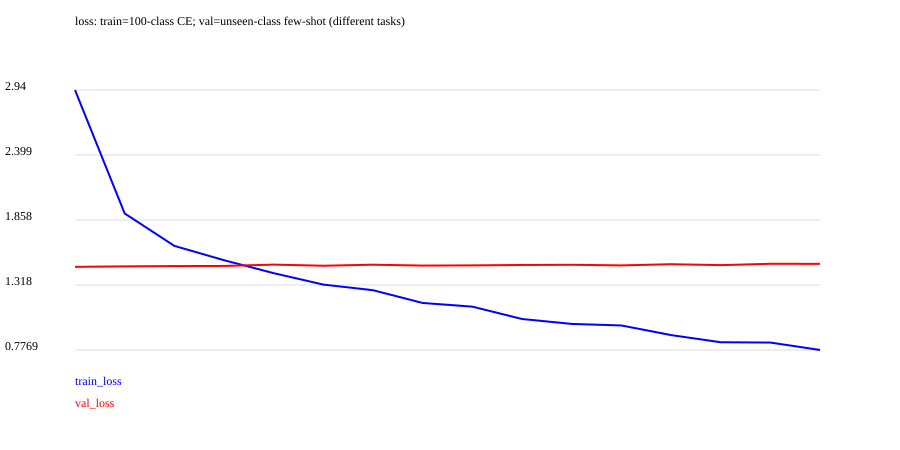
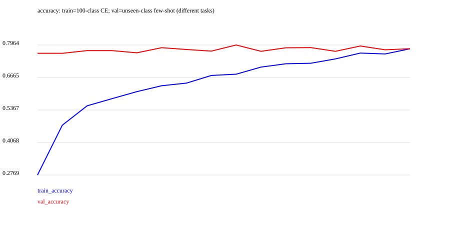
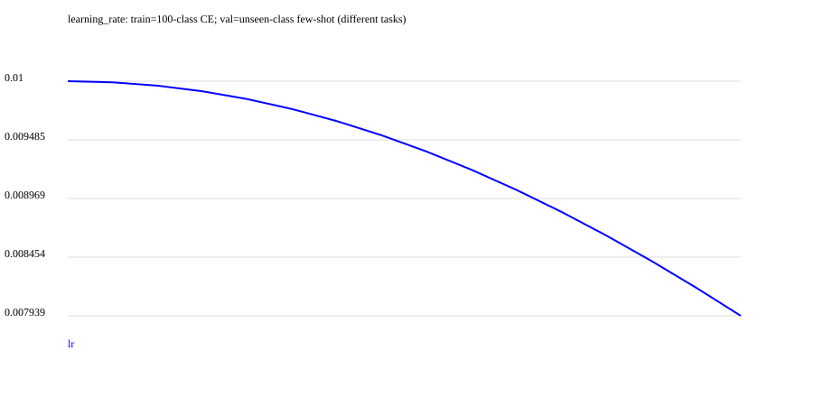
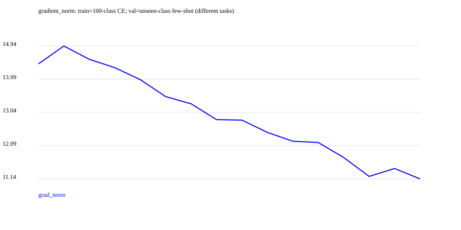

# Stage04监督训练结果

训练使用100类监督分类头；验证复用未见类cosine原型评分。Train/Val Loss与Accuracy属于不同任务，不可当作同一个分类头的训练/验证差距。验证不使用NABirds或CUB test。

```json
{
  "status": "running",
  "best_epoch": 9,
  "best_validation_accuracy": 0.7963999999999999
}
```

[配置](config.json) · [逐epoch CSV](logs/epochs.csv) · [逐step CSV](logs/steps.csv) · [运行日志](logs/run.log)









Checkpoint为epoch边界恢复，包含分类头、optimizer、scheduler和AMP scaler。修改batch size恢复会改变训练轨迹。未承诺跨硬件位级一致或中途batch精确续训。
