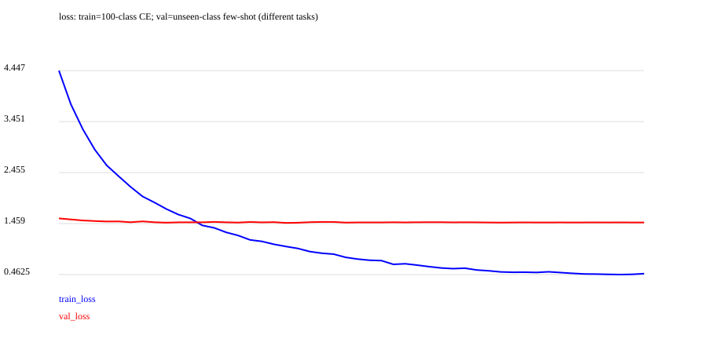
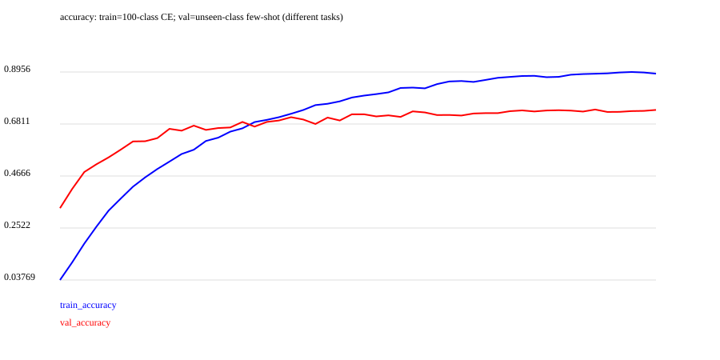
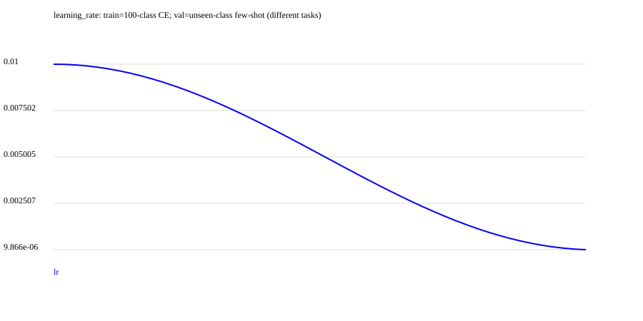
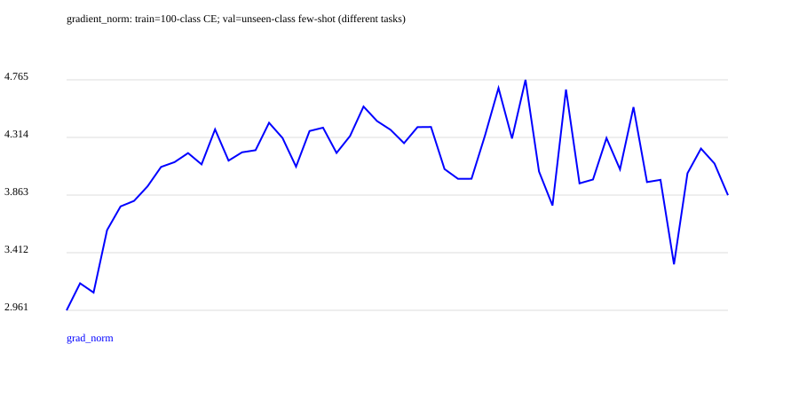

# Stage04监督训练结果

训练使用100类监督分类头；验证复用未见类cosine原型评分。Train/Val Loss与Accuracy属于不同任务，不可当作同一个分类头的训练/验证差距。验证不使用NABirds或CUB test。

```json
{
  "status": "completed",
  "best_epoch": 45,
  "best_validation_accuracy": 0.7408000000000001,
  "best_validation": {
    "accuracy": 0.7408000000000001,
    "nll": 1.4806873718305826,
    "macro_f1": 0.7269284826284828,
    "ece": 0.5086545413236986,
    "episode_accuracies": [
      0.76,
      1.0,
      0.76,
      0.76,
      0.92,
      0.64,
      0.8,
      0.76,
      0.72,
      0.88,
      0.52,
      0.68,
      0.76,
      0.84,
      0.88,
      0.48,
      0.76,
      0.6,
      0.72,
      0.88,
      0.68,
      0.48,
      0.68,
      0.6,
      0.84,
      1.0,
      0.64,
      0.76,
      0.88,
      0.8,
      0.84,
      0.8,
      0.68,
      0.6,
      0.64,
      0.64,
      0.72,
      0.52,
      0.8,
      0.72,
      0.6,
      0.92,
      0.8,
      0.88,
      0.6,
      0.76,
      0.6,
      0.72,
      0.8,
      1.0,
      0.8,
      0.72,
      0.76,
      0.64,
      0.64,
      0.88,
      0.68,
      0.76,
      0.84,
      0.8,
      0.64,
      0.68,
      0.8,
      0.6,
      0.76,
      0.72,
      0.72,
      0.52,
      0.96,
      0.48,
      0.96,
      0.64,
      0.68,
      0.92,
      0.64,
      0.76,
      0.6,
      0.56,
      0.88,
      0.88,
      0.64,
      0.6,
      0.92,
      0.64,
      0.52,
      0.76,
      0.68,
      0.56,
      0.84,
      0.92,
      0.84,
      0.88,
      0.84,
      0.96,
      0.72,
      0.8,
      0.76,
      0.68,
      0.76,
      0.72
    ],
    "episode_std": 0.1264246491756727,
    "episodes": 100,
    "samples": 2500,
    "confusion_matrix": [
      [
        372,
        23,
        28,
        43,
        34
      ],
      [
        24,
        393,
        30,
        27,
        26
      ],
      [
        20,
        45,
        359,
        40,
        36
      ],
      [
        28,
        30,
        38,
        369,
        35
      ],
      [
        32,
        36,
        37,
        36,
        359
      ]
    ],
    "confusion_matrix_labels": "episode-local class slots; rows=true, columns=predicted",
    "calibration_bins": 15,
    "metric_aggregation": "unweighted mean of episode accuracy, NLL, macro-F1 and ECE",
    "loss": 1.4806873718305826
  },
  "best_reload_validation_reproduced": true,
  "best_checkpoint": "/root/autodl-tmp/test/few-shot-fine-grained-generalization/outputs/stage04_training/supervised_simclr_seed42_bs128/checkpoints/best.pth",
  "last_checkpoint": "/root/autodl-tmp/test/few-shot-fine-grained-generalization/outputs/stage04_training/supervised_simclr_seed42_bs128/checkpoints/last.pth",
  "backbone_export": "/root/autodl-tmp/test/few-shot-fine-grained-generalization/outputs/stage04_training/supervised_simclr_seed42_bs128/checkpoints/backbone_best.pth",
  "epochs_completed": 50,
  "validation_kind": "unseen-class episodic cosine prototypes",
  "train_kind": "supervised 100-base-class head (actual count in config)",
  "amp_effective": true
}
```

[配置](config.json) · [逐epoch CSV](logs/epochs.csv) · [逐step CSV](logs/steps.csv) · [运行日志](logs/run.log)









Checkpoint为epoch边界恢复，包含分类头、optimizer、scheduler和AMP scaler。修改batch size恢复会改变训练轨迹。未承诺跨硬件位级一致或中途batch精确续训。
