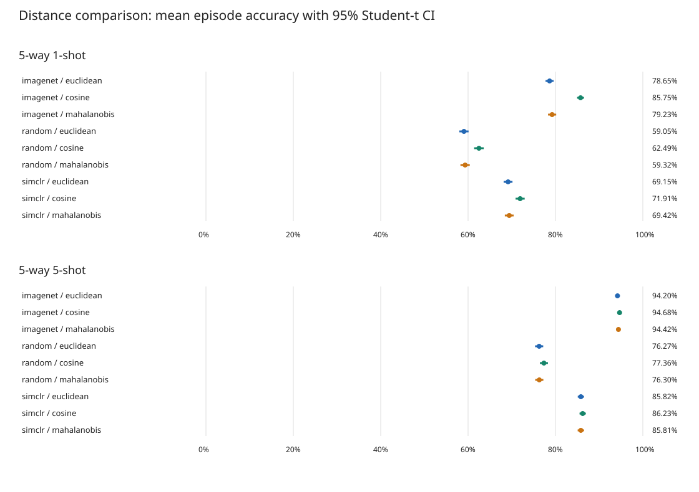
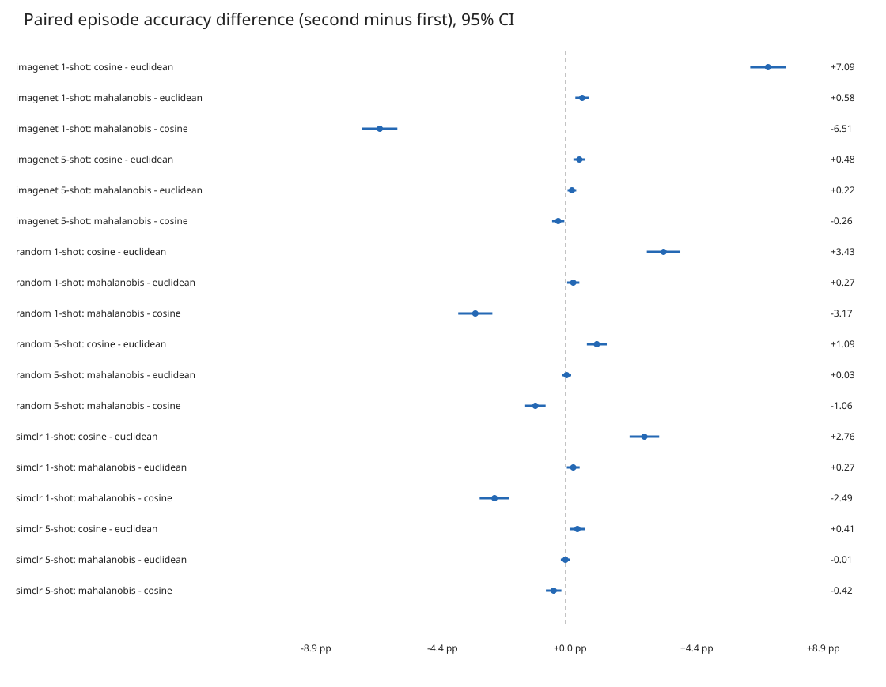

# Stage 05：仅改变距离的配对对比实验

**固定阶段4 Backbone、原始Val特征缓存、Support均值原型、600对Episode和数据划分；只改变距离。** 不训练Backbone，不用NABirds。本次新增7200次Episode评分；既有3600次欧氏结果直接复用，总表覆盖10800次评分。

| 初始化 | 距离 | Shot | Mean Accuracy | 样本标准差（pp） | 95% CI |
|---|---|---:|---:|---:|---|
| imagenet | euclidean | 1 | 78.653% | 11.520 | [77.730%, 79.577%] |
| imagenet | cosine | 1 | 85.747% | 9.786 | [84.962%, 86.531%] |
| imagenet | mahalanobis | 1 | 79.233% | 11.648 | [78.299%, 80.167%] |
| imagenet | euclidean | 5 | 94.200% | 5.402 | [93.767%, 94.633%] |
| imagenet | cosine | 5 | 94.680% | 5.338 | [94.252%, 95.108%] |
| imagenet | mahalanobis | 5 | 94.420% | 5.419 | [93.986%, 94.854%] |
| random | euclidean | 1 | 59.053% | 13.213 | [57.994%, 60.113%] |
| random | cosine | 1 | 62.487% | 13.679 | [61.390%, 63.583%] |
| random | mahalanobis | 1 | 59.320% | 13.300 | [58.254%, 60.386%] |
| random | euclidean | 5 | 76.267% | 11.630 | [75.334%, 77.199%] |
| random | cosine | 5 | 77.360% | 11.499 | [76.438%, 78.282%] |
| random | mahalanobis | 5 | 76.300% | 11.609 | [75.369%, 77.231%] |
| simclr | euclidean | 1 | 69.153% | 12.595 | [68.143%, 70.163%] |
| simclr | cosine | 1 | 71.913% | 12.959 | [70.874%, 72.952%] |
| simclr | mahalanobis | 1 | 69.420% | 12.574 | [68.412%, 70.428%] |
| simclr | euclidean | 5 | 85.820% | 8.923 | [85.105%, 86.535%] |
| simclr | cosine | 5 | 86.233% | 9.017 | [85.510%, 86.956%] |
| simclr | mahalanobis | 5 | 85.813% | 9.112 | [85.083%, 86.544%] |

## 严格固定的部分

- 直接读取并逐字节复制原`plan_1shot.json/plan_5shot.json/paired_episodes.jsonl/image_catalog.csv`，没有重新采样。两种Shot类别和Query相同，1-shot Support是5-shot Support子集。
- 三组Val特征直接读取旧缓存，校验完整binding、权重SHA256、编码器state指纹、Transform、输入内容指纹、特征SHA256、shape及dtype，不重新提取或转换Val特征。
- 图像预处理仍是RGB、Resize257、CenterCrop224、ToTensor、ImageNet像素Normalize。像素Normalize与特征L2归一化不同。
- 原始512维特征不做额外L2归一化或标准化。每个原型始终为原始Support特征算术平均，不预先归一化Support，不归一化或重建原型。
- 欧氏结果仅核验已有预测ID/Accuracy/统计并引用原文件；不重新计算其600个Episode，也不改旧目录任何文件。`baseline_references.json`保存原结果位置和SHA256。

## 三种距离的精确定义

`p_c = mean_k Support[c,k]`，所有距离使用同一个原始均值原型。

- **Euclidean**：沿用旧`prototype_scores`的平方欧氏分支，`logits=-sum((q-p)^2)/512`；结果直接复用。
- **Cosine**：复用旧`prototype_scores(..., metric="cosine")`。该函数先求原始均值原型，然后在距离公式内部对q和p除以各自范数，eps=1e-12。`distance=1-cos(q,p)`，实际`logits=cos(q,p)`，与负余弦距离仅差所有类别共享常数1，Softmax与argmax相同。没有把归一化后的Support均值作为原型。
- **Mahalanobis**：新增全局共享对角版本。使用原始q、p，`D=sum_d((q_d-p_cd)^2/v_d)`，实际`logits=-D/512`。未开平方；以逐元素除法计算，禁止矩阵求逆。原型均值保持float32，协方差估计与距离累加用float64提高稳定性，最终logits转回float32。
现有Episode-Support收缩马氏分支保持原样，本次没有使用它，也没有将其结果混入共享Train协方差实验。所有温度均固定为1，没有调温或额外归一化消融。不同距离的NLL/概率尺度不同，本实验主要比较Accuracy。

## Train类内共享对角协方差

每个Backbone分别对5890张/100类CUB Train图片使用同一确定性eval预处理提取原始特征，eval模式、冻结参数、无优化器。只把Train标签传入协方差估计器，不传Val/Query特征或标签。

1. 计算每个Train类别的均值mu_c。
2. 计算类内残差x_i-mu_yi，池化方差`S_d=sum_i residual_id^2/(N-C)`；实际自由度为5890-100=5790，不包含类间均值差异。
3. `scale=mean_d(S_d)`；`v_d=(1-alpha)*S_d+alpha*scale+jitter`。
4. 默认固定`alpha=0.1`、`jitter=max(1e-8,1e-4*scale)`，没有根据Val或NABirds调参。同一Backbone的v同时用于1-shot和5-shot所有Episode。
完整原始方差、正则化对角线、输入Train特征哈希、样本清单、类计数、正则化数值及条件数见各模型`covariance.json`和`covariance_diagonal.csv`。全局协方差是本次马氏度量需要估计的统计量，不是Backbone训练或额外特征变换。

## 配对准确率差值

同一初始化、同一Shot、同一个episode_id进行距离配对。`delta_e=Accuracy_second,e-Accuracy_first,e`，报告均值差（百分点）和对600个delta的Student-t 95% CI；不是将两个独立CI相减。统计为描述性，未进行多重比较校正。

| 初始化 | Shot | second − first | 平均差（pp） | 配对95% CI（pp） |
|---|---:|---|---:|---|
| imagenet | 1 | cosine − euclidean | +7.093 | [+6.471, +7.715] |
| imagenet | 1 | mahalanobis − euclidean | +0.580 | [+0.340, +0.820] |
| imagenet | 1 | mahalanobis − cosine | -6.513 | [-7.128, -5.898] |
| imagenet | 5 | cosine − euclidean | +0.480 | [+0.273, +0.687] |
| imagenet | 5 | mahalanobis − euclidean | +0.220 | [+0.069, +0.371] |
| imagenet | 5 | mahalanobis − cosine | -0.260 | [-0.474, -0.046] |
| random | 1 | cosine − euclidean | +3.433 | [+2.846, +4.021] |
| random | 1 | mahalanobis − euclidean | +0.267 | [+0.053, +0.480] |
| random | 1 | mahalanobis − cosine | -3.167 | [-3.765, -2.569] |
| random | 5 | cosine − euclidean | +1.093 | [+0.744, +1.442] |
| random | 5 | mahalanobis − euclidean | +0.033 | [-0.127, +0.193] |
| random | 5 | mahalanobis − cosine | -1.060 | [-1.419, -0.701] |
| simclr | 1 | cosine − euclidean | +2.760 | [+2.241, +3.279] |
| simclr | 1 | mahalanobis − euclidean | +0.267 | [+0.042, +0.491] |
| simclr | 1 | mahalanobis − cosine | -2.493 | [-3.013, -1.973] |
| simclr | 5 | cosine − euclidean | +0.413 | [+0.138, +0.689] |
| simclr | 5 | mahalanobis − euclidean | -0.007 | [-0.169, +0.155] |
| simclr | 5 | mahalanobis − cosine | -0.420 | [-0.691, -0.149] |

## 图表与输出





[完整表](comparison.csv) · [配对表](paired_comparison.csv) · [逐Episode差值](paired_episode_differences.csv) · [配置](config.json) · [验收](checks.json) · [日志](run.log)

新增距离的每个模型/Shot均保存`episodes.csv`、`metrics.json`、`predictions.jsonl`，预测包含样本ID、原始与局部标签、真实/预测类别、全部5个logits和概率。Support信息通过episode_id连接本目录复制的`paired_episodes.jsonl`。欧氏完整预测保留在旧目录，通过`baseline_references.json`引用，不复制或覆盖其日志。

**本次仍为CUB Val验证集评估，三个Checkpoint曾用此Val选择最佳轮次，不应称为独立最终测试或NABirds跨数据集成绩。CI单位为Episode，不包含训练seed或模型选择不确定性。**

## 运行命令

```bash
uv run python -m pattern_recognition_coursework.engine.distance_comparison \
  --baseline-dir outputs/stage05_protonet/episodic_eval_seed42_600 \
  --baseline-cache-dir data/cache/stage05_features \
  --output-dir outputs/stage05_protonet/distance_comparison_server \
  --device cuda --batch-size 64 --workers 4
```

输出目录必须不存在。服务器需同步三份旧Val缓存.pt（约17.3 MiB），不能只同步Git中的报告；缺少旧缓存时明确报错，不悄悄重新提取或改变特征。`--cache-dir`控制新增Train特征缓存位置；本地CPU使用`--device cpu --workers 0`。

## 独立进程核验

独立进程已复算三个Train类内协方差、全部7200个新Episode的公式与180000条预测、18组配对统计；logits和概率逐位复现，原始均值原型哈希不变，旧欧氏目录全部文件哈希不变。 37项测试通过。[核验证据](independent_verification.json) · [测试日志](../distance_comparison_tests/pytest.log)。
