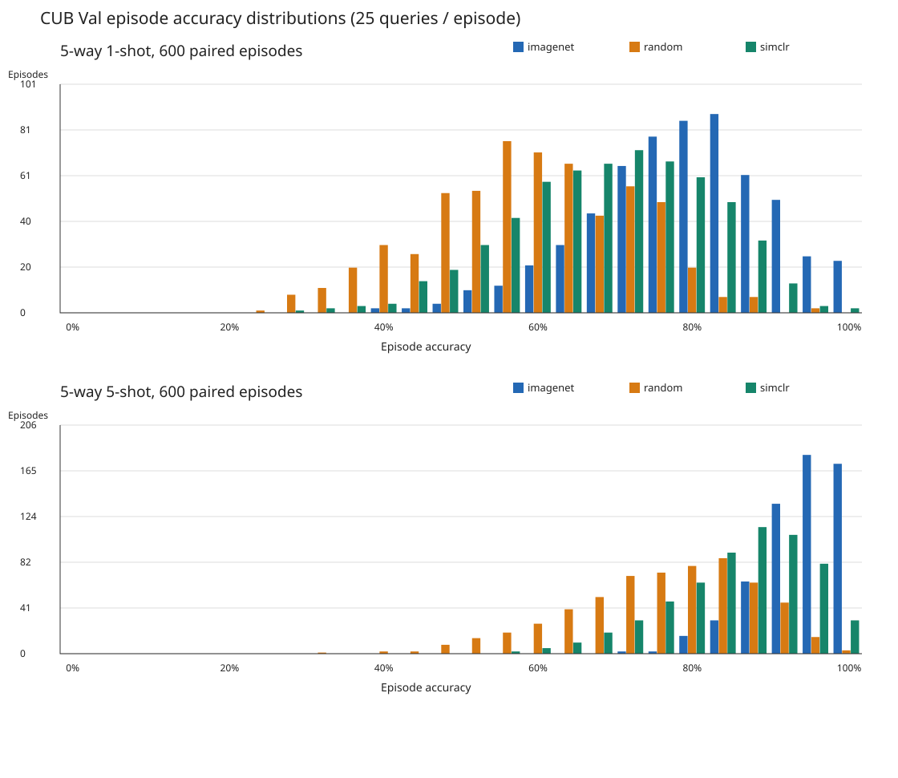

# Stage 05：成对批量 Episodic Evaluation

**CUB Val验证集评估，不是NABirds测试，也不是独立最终测试。** 三个Checkpoint在阶段4已使用CUB Val选最佳，本次只检验固定模型在更多任务上的表现，不再选模型或调整超参数。

每种shot使用600个固定seed=42的5-way Episode，每类5张Query。三组模型共评分3600个Episode、90000个Query预测（同一图片可以在不同Episode重复出现）。

| 初始化 | Shot | Mean Accuracy | 样本标准差（百分点） | 95% CI |
|---|---:|---:|---:|---|
| imagenet | 1 | 78.653% | 11.520 | [77.730%, 79.577%] |
| imagenet | 5 | 94.200% | 5.402 | [93.767%, 94.633%] |
| random | 1 | 59.053% | 13.213 | [57.994%, 60.113%] |
| random | 5 | 76.267% | 11.630 | [75.334%, 77.199%] |
| simclr | 1 | 69.153% | 12.595 | [68.143%, 70.163%] |
| simclr | 5 | 85.820% | 8.923 | [85.105%, 86.535%] |

## 固定协议与复用

- 数据：原始划分不改，清洗后的CUB Val 50类/2947张。全部实际图片重新SHA256核验；与CUB训练集在类别、ID、路径及已审计内容哈希上互斥。
- 从原`FewShotBatchSampler`生成5-shot计划：每类无放回采10张，前5张Support，后5张Query。1-shot只保留每类第1张Support，完整保留相同Query及类别顺序。用原`validate_plan`校验两个清单，再检查配对子集关系。
- 同一shot的三个Backbone读取同一plan对象。`paired_episodes.jsonl`保存Support/Query官方ID、相对路径、内容哈希和局部标签；`image_catalog.csv`提供完整数据映射，两个`plan_*shot.json`保持现有清单格式。
- 确定性预处理：RGB → Resize短边257 → CenterCrop224 → ToTensor → ImageNet Normalize；无测试随机增强。
- 复用`FewShotModel.encode/classify_embeddings`与`prototype_scores`：eval模式、冻结参数、512维GAP特征；无L2归一化、标准化、Adapter，温度1。原型为类内Support均值，logits=`-平方欧氏距离/512`。没有增加或替换度量。
- 复用`evaluation_metrics/aggregate_episode_metrics`计算逐Episode准确率等。原评估入口要求旧episodic Checkpoint，不能直接读取阶段4监督Checkpoint，因此新增独立入口，训练模块不改。

## 指标与置信区间

`a_e = 本Episode正确Query数 / 25`；`mean = Σa_e/n`；样本标准差`s = sqrt(Σ(a_e-mean)^2/(n-1))`；`SEM=s/sqrt(n)`；`95% CI = mean ± t(0.975,n-1)*SEM`。CI不裁剪边界。
统计单位是Episode，不是将15000张Query当作独立样本。这里的CI仅衡量给定Checkpoint和固定CUB Val上随机任务采样的均值不确定性，不包括训练seed、模型选择、数据集抽样或跨数据集不确定性；三种初始化当前各只有一个训练seed。标准差不是标准误。

## 冻结特征缓存

- 每个模型只编码一次2947张验证图；对每个Episode仍重新从其Support求原型。缓存图像特征，不缓存跨Episode原型。
- cache绑定Checkpoint完整SHA256、编码器state指纹、ordered数据指纹及实际图片内容哈希、Transform完整repr及版本、图像尺寸、RGB、eval模式、冻结状态、float32、编码器源码和运行环境（设备、批量大小等）。不复用训练模式或其他权重/预处理的缓存。
- 缓存读取时同时校验binding、`[2947,512]`尺寸、dtype、有限性与特征内容哈希；不匹配即报错。缓存文件通过临时文件原子发布。
- 每个模型/shot前3个Episode另用实际图片直接前向，并调用现有`run_episodes`交叉检查缓存结果；logits容差1e-5绝对值/1e-4相对值，预测必须完全相同。

## 图表与证据



[比较表](comparison.csv) · [统计JSON](summary.json) · [配置](config.json) · [采样核验](plan_checks.json) · [数据核验](data_audit.json) · [Checkpoint绑定](checkpoints.json) · [验收](checks.json) · [实际日志](run.log)

- **imagenet**：[缓存绑定](imagenet/cache.json) · [直接前向核验](imagenet/direct_verification.json)；[1-shot准确率](imagenet/1shot/episodes.csv) · [1-shot全部预测](imagenet/1shot/predictions.jsonl)；[5-shot准确率](imagenet/5shot/episodes.csv) · [5-shot全部预测](imagenet/5shot/predictions.jsonl)。
- **random**：[缓存绑定](random/cache.json) · [直接前向核验](random/direct_verification.json)；[1-shot准确率](random/1shot/episodes.csv) · [1-shot全部预测](random/1shot/predictions.jsonl)；[5-shot准确率](random/5shot/episodes.csv) · [5-shot全部预测](random/5shot/predictions.jsonl)。
- **simclr**：[缓存绑定](simclr/cache.json) · [直接前向核验](simclr/direct_verification.json)；[1-shot准确率](simclr/1shot/episodes.csv) · [1-shot全部预测](simclr/1shot/predictions.jsonl)；[5-shot准确率](simclr/5shot/episodes.csv) · [5-shot全部预测](simclr/5shot/predictions.jsonl)。

每条预测记录提供全部5个logits、概率、真实标签与类别、预测类别、样本ID及路径；Support集合通过同一episode_id连接`paired_episodes.jsonl`。

## 运行命令

```bash
uv run python -m pattern_recognition_coursework.engine.episodic_evaluation \
  --output-dir outputs/stage05_protonet/episodic_eval_seed42_600_new \
  --episodes 600 --seed 42 --device auto --batch-size 64 --workers 0
```

输出目录必须是新的，避免覆盖旧实验。默认读取本地三组阶段4完整`best.pth`。可用`--imagenet-checkpoint`、`--random-checkpoint`、`--simclr-checkpoint`显式指定。`--cache-dir`指定可复用的缓存位置；`--no-cache`关闭磁盘读写但仍一次提取全部冻结特征；`--batch-size`仅控制特征编码批量，不改变Episode数量。服务器可使用`--device cuda --workers 4`。

若原始数据路径不同，指定`--data-root`、`--splits-dir`；只改变根目录，不改变索引内容。检查源码、输入权重在评估前后均保持不变，未创建优化器，也未读NABirds或CUB Test图片。

## 独立进程复核

已在独立进程从磁盘读取缓存和完整预测，对全部3600个Episode、90000个Query逐项复算：logits与概率逐位相等，ID/标签/类别名称和预测一致，均值、ddof=1标准差与Student-t CI独立重算一致。[完整证据](independent_verification.json)。26项回归测试通过：[测试日志](../batch_evaluation_tests/pytest.log)。
