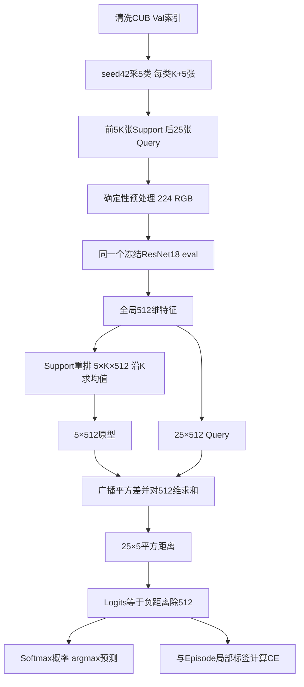

# Stage 05：ProtoNet 数据流与数学核验

本阶段只做前向验证。使用阶段4三组已完成50轮的最优Checkpoint，在CUB clean Val上执行固定seed=42的5-way 1-shot和5-shot任务，每类5个Query。不同初始化使用同一份任务计划；不读取CUB Test或NABirds图片，不训练或选择新Checkpoint。

**所有核心检查通过。每个设置仅1个Episode，下面准确率用于展示流程，不是正式泛化成绩；这些Checkpoint原本也由CUB Val选择，因此不能将本检查称为独立最终测试。**

## 代码调用关系

- `data/cub_dataset.py:CUBFewShotDataset/get_cub_transforms`：清洗索引、分区本地标签、确定性预处理。
- `data/cub_dataset.py:FewShotBatchSampler.__iter__`：先采5类，每类无放回抽K+Q张，最后返回按类分组的全部Support，再返回按同一类序排列的Query。
- `data/episodes.py:load_or_create_plan/validate_plan`：持久化索引、数据指纹、数量与分组顺序验证。
- `models/few_shot.py:FewShotModel.forward → encode → classify_embeddings`：共用一个ResNet-18编码器，按位置切分Support/Query。
- `models/metrics/episode.py:prototype_scores`：Support按`[5,K,512]`重排，沿K维求均值，然后计算距离分数。
- `engine/experiment.py:run_episodes`：eval模式，无优化器，不求梯度；生成局部Query标签`arange(5).repeat_interleave(5)`，计算CE与预测。
- `scripts/check_stage05_protonet.py`：独立公式、内容哈希、重复前向、完整引擎交叉核验和可视化。

## 数据、标签与Tensor Shape

数据来自2947张/50类的CUB清洗验证集，与5890张/100类的训练集在类别、图像ID、路径、内容哈希上互斥。每张选中图片的SHA256会重新计算并核对清洗索引。`members.csv`记录原始官方图像ID、Val本地标签、Episode局部0～4标签、路径和内容哈希。局部类别顺序来自采样顺序，不是鸟类名称排序。

实际预处理：RGB → Resize短边257（默认bilinear）→ CenterCrop224 → ToTensor(float32,0～1) → ImageNet Normalize(mean=.485/.456/.406,std=.229/.224/.225)。测试没有随机裁剪、翻转或ColorJitter。可视化先反归一化到RGB，不把归一化Tensor直接当图片。

| 阶段 | 5-way 1-shot | 5-way 5-shot |
|---|---|---|
| Support图片 | `[5,3,224,224]` | `[25,3,224,224]` |
| Query图片（每类5张） | `[25,3,224,224]` | `[25,3,224,224]` |
| 拼接输入 | `[30,3,224,224]` | `[50,3,224,224]` |
| Conv1 | `[30,64,112,112]` | `[50,64,112,112]` |
| Layer1（经maxpool） | `[30,64,56,56]` | `[50,64,56,56]` |
| Layer2 | `[30,128,28,28]` | `[50,128,28,28]` |
| Layer3 | `[30,256,14,14]` | `[50,256,14,14]` |
| Layer4 | `[30,512,7,7]` | `[50,512,7,7]` |
| GAP + Flatten | `[30,512]` | `[50,512]` |
| Support重排 | `[5,1,512]` | `[5,5,512]` |
| 类别均值原型 | `[5,512]` | `[5,512]` |
| Query-原型广播差 | `[25,5,512]` | `[25,5,512]` |
| 距离 / logits / 概率 | 均为`[25,5]` | 均为`[25,5]` |
| Query标签 / 预测 | 均为`[25]`，int64 | 均为`[25]`，int64 |

上述主干中间形状由运行时hook实际记录在各初始化的`weight_loading.json`。所有特征和分数为float32，输入范围、特征范围/均值/标准差/L2范数及标签完整保存在`evidence.json`和运行日志。



## 数学计算及关键缩放

原型：`p_c = (1/K) Σ_k f(x_support[c,k])`。1-shot时原型就是该类唯一Support的特征；5-shot时是该类5张Support特征的均值。原型不使用Query，也不使用Query标签。

平方欧氏距离：`D[i,c] = Σ_d (q[i,d] - p[c,d])²`，形状`[25,5]`。

**现有实现实际返回`logits = -D / 512 / T`，本阶段T=1；没有特征L2归一化、Episode标准化、Adapter或局部融合。它与直接`-D`的argmax相同，但Softmax概率与CE不同。没有悄悄删除除512，也没有把它称作未经缩放的原始距离。**

概率：`P[i,c] = exp(logits[i,c]) / Σ_j exp(logits[i,j])`。每行概率和为1；预测为`argmax(P)`，等价于`argmin(D)`。损失：`CE = mean(logsumexp(logits[i,:]) - logits[i,y_i])`。PyTorch CE接收logits，不先传Softmax。

`raw_squared.csv`保存D；`scaled_squared.csv`保存D/512；`logits.csv`保存-D/512；`probabilities.csv`保存实际概率。`unscaled_probabilities.csv`及evidence中的unscaled loss仅用于说明如果直接使用-D会产生怎样的不同，不作为项目实际预测概率。

## Checkpoint与结果

| 初始化 | Stage04最佳轮次 | 1-shot正确数/25 | 5-shot正确数/25 |
|---|---:|---:|---:|
| imagenet | 17 | 20 | 24 |
| random | 45 | 16 | 21 |
| simclr | 45 | 21 | 21 |

完整监督Checkpoint只加载`model`中的`backbone.`前缀，明确排除`classifier.weight/bias`两个张量。与Checkpoint内120个编码器state逐项精确相等，参数和BN缓冲区在核验前后均未改变；权重文件的SHA256也未改变。未使用监督100类分类头，也没有把未训练的新编码器冒充阶段4模型。

## 可视化入口

- **imagenet / 1-shot**：[完整Episode](imagenet/5way_1shot/episode.png) · [平方距离热力图](imagenet/5way_1shot/distance_heatmap.png) · [预测概率热力图](imagenet/5way_1shot/probability_heatmap.png) · [所有Query预测](imagenet/5way_1shot/predictions.csv) · [原型统计](imagenet/5way_1shot/prototype_statistics.json) · [错误清单](imagenet/5way_1shot/errors.json)
  错分5张。[错误图集](imagenet/5way_1shot/errors.png)
- **imagenet / 5-shot**：[完整Episode](imagenet/5way_5shot/episode.png) · [平方距离热力图](imagenet/5way_5shot/distance_heatmap.png) · [预测概率热力图](imagenet/5way_5shot/probability_heatmap.png) · [所有Query预测](imagenet/5way_5shot/predictions.csv) · [原型统计](imagenet/5way_5shot/prototype_statistics.json) · [错误清单](imagenet/5way_5shot/errors.json)
  错分1张。[错误图集](imagenet/5way_5shot/errors.png)
- **random / 1-shot**：[完整Episode](random/5way_1shot/episode.png) · [平方距离热力图](random/5way_1shot/distance_heatmap.png) · [预测概率热力图](random/5way_1shot/probability_heatmap.png) · [所有Query预测](random/5way_1shot/predictions.csv) · [原型统计](random/5way_1shot/prototype_statistics.json) · [错误清单](random/5way_1shot/errors.json)
  错分9张。[错误图集](random/5way_1shot/errors.png)
- **random / 5-shot**：[完整Episode](random/5way_5shot/episode.png) · [平方距离热力图](random/5way_5shot/distance_heatmap.png) · [预测概率热力图](random/5way_5shot/probability_heatmap.png) · [所有Query预测](random/5way_5shot/predictions.csv) · [原型统计](random/5way_5shot/prototype_statistics.json) · [错误清单](random/5way_5shot/errors.json)
  错分4张。[错误图集](random/5way_5shot/errors.png)
- **simclr / 1-shot**：[完整Episode](simclr/5way_1shot/episode.png) · [平方距离热力图](simclr/5way_1shot/distance_heatmap.png) · [预测概率热力图](simclr/5way_1shot/probability_heatmap.png) · [所有Query预测](simclr/5way_1shot/predictions.csv) · [原型统计](simclr/5way_1shot/prototype_statistics.json) · [错误清单](simclr/5way_1shot/errors.json)
  错分4张。[错误图集](simclr/5way_1shot/errors.png)
- **simclr / 5-shot**：[完整Episode](simclr/5way_5shot/episode.png) · [平方距离热力图](simclr/5way_5shot/distance_heatmap.png) · [预测概率热力图](simclr/5way_5shot/probability_heatmap.png) · [所有Query预测](simclr/5way_5shot/predictions.csv) · [原型统计](simclr/5way_5shot/prototype_statistics.json) · [错误清单](simclr/5way_5shot/errors.json)
  错分4张。[错误图集](simclr/5way_5shot/errors.png)

完整Episode图列为Episode类别，先显示K行Support，再显示5行Query。每张图显示角色、真实局部类别、Query预测与置信度，以及真实类别名称和样本相对路径；顶部给出0～4类别名称对照。错误图集补充预测类别名称，CSV/JSON提供未截断路径。

## 自动核验与可复现性

- 人工5类二维向量同时验证1-shot/5-shot，原型与手写25项平方距离逐项相等；实际分数需除以特征维数2，而非真实图像特征的512。见`toy_vectors.json`。
- 真实数据每类Support/Query数量正确；索引、官方ID、路径、SHA256均唯一；所选数据内容与清洗CSV一致。
- 独立均值/广播平方距离/稳定Softmax/logsumexp损失与现有分类分支、完整`run_episodes`引擎一致。
- 每个设置重复3次：重新seed、采样、读取与预处理、完整前向；索引、输入、logits和预测均逐位相同。另一次独立进程重跑结果见`rerun_verification.json`。
- 模型eval、所有参数requires_grad=False、inference_mode、无优化器；参数及BN state逐位不变。
- 这是当前CPU环境内的确定性验证；不承诺跨GPU/跨硬件逐位一致。

运行配置、环境、命令、源码哈希、权重加载清单和任务计划保存在本目录。`checks.json`为总验收，`run.log`为实际运行日志，`tests/`保存小规模回归证据。

## 一个真实Query的具体数值

以ImageNet初始化Checkpoint的1-shot任务第0张Query为例：

- 真实类别：`153.Philadelphia_Vireo`，Episode标签`0`。
- 图片路径：`images/153.Philadelphia_Vireo/Philadelphia_Vireo_0085_794757.jpg`。

| 原型局部类别 | 原始平方距离D | 实际logit=-D/512 | Softmax概率 |
|---|---:|---:|---:|
| 0 | 737.757080 | -1.440932 | 0.177152 |
| 1 | 683.661377 | -1.335276 | 0.196893 |
| 2 | 652.449524 | -1.274315 | 0.209269 |
| 3 | 709.464355 | -1.385673 | 0.187216 |
| 4 | 605.270325 | -1.182169 | 0.229469 |

最近原型/最大概率对应类别`4`（`078.Gray_Kingbird`）。真实类别的本张Query负对数概率为`1.730749`；Episode CE是25张Query对应损失的平均值。这个样本预测错误，说明流程检查通过不意味着所有图片都会分类正确。

## 最终验证证据与复跑命令

- 11项自动化测试全部通过：[pytest日志](tests/pytest.log)、[JUnit](tests/junit.xml)。测试包括人工向量、错误距离缩放拒绝、不同标签/不同路径但内容相同的样本拒绝，以及现有few-shot/指标回归。
- 新进程重新加载三组Checkpoint、重新生成seed42任务，对六个Episode的特征、logits、概率和预测逐位核对，最大差值全部为0：[复跑证据](rerun_verification.json)、[复跑日志](replay.log)。
- 三种初始化在同一shot设置下的members.csv逐字节一致。参数、BN缓冲区、权重文件、原有src模块均未改变。
- 初次运行脚本的精确源码快照：[audit_source_initial.py](audit_source_initial.py)。源码与后续带`--replay`入口的脚本分别记录SHA256，避免将两个版本混为一谈。

```bash
# 首次审计（已有默认目录时拒绝覆盖；复跑请指定新的空目录）
uv run python scripts/check_stage05_protonet.py \
  --output-dir outputs/stage05_protonet/recheck_seed42

# 新进程对照该次保存的完整特征、分数、概率和预测
uv run python scripts/check_stage05_protonet.py --replay \
  --output-dir outputs/stage05_protonet/recheck_seed42
```

以上执行不创建优化器、不更新权重、不下载模型；使用本地阶段4完整best.pth。目录须保持同一工程布局，数据和Checkpoint需可读。
