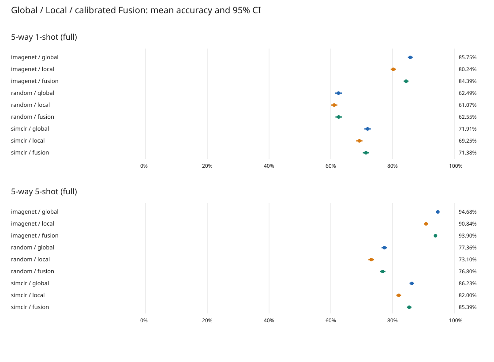
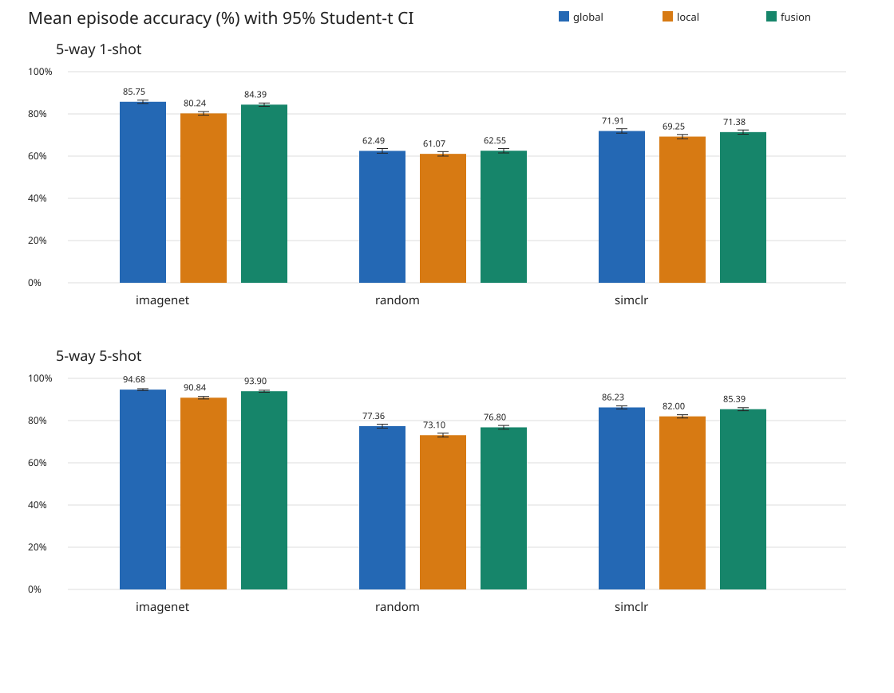
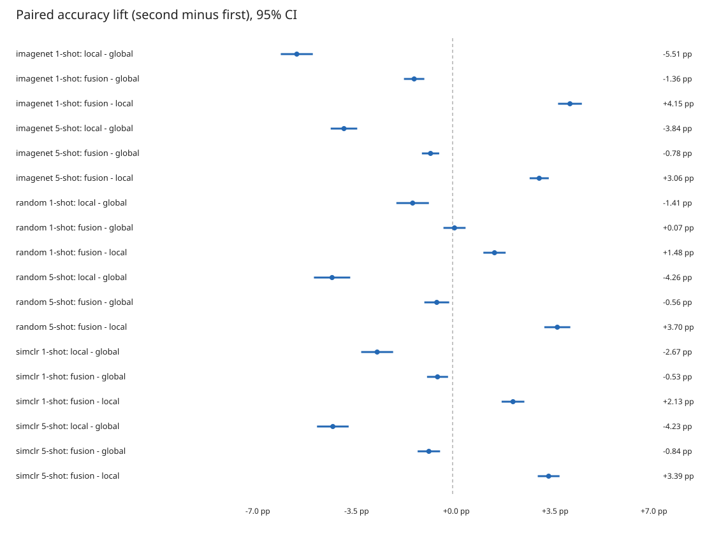

# Global / Local / Fusion 冻结表示对比

模式：**full**；实际设备：**NVIDIA GeForce MX450**，dtype=float32。每种Shot实际使用原计划前600个Episode；不重采样，不训练，不读取NABirds。

完整批量评估：三种Backbone、两种Shot、每种600个Episode；Global原结果直接复用。

| 初始化 | 表示 | Shot | Mean Accuracy | 样本标准差（pp） | 95% CI |
|---|---|---:|---:|---:|---|
| imagenet | global | 1 | 85.747% | 9.786 | [84.962%, 86.531%] |
| imagenet | local | 1 | 80.240% | 10.523 | [79.396%, 81.084%] |
| imagenet | fusion | 1 | 84.387% | 9.744 | [83.605%, 85.168%] |
| imagenet | global | 5 | 94.680% | 5.338 | [94.252%, 95.108%] |
| imagenet | local | 5 | 90.840% | 7.392 | [90.247%, 91.433%] |
| imagenet | fusion | 5 | 93.900% | 5.883 | [93.428%, 94.372%] |
| random | global | 1 | 62.487% | 13.679 | [61.390%, 63.583%] |
| random | local | 1 | 61.073% | 13.176 | [60.017%, 62.130%] |
| random | fusion | 1 | 62.553% | 13.163 | [61.498%, 63.609%] |
| random | global | 5 | 77.360% | 11.499 | [76.438%, 78.282%] |
| random | local | 5 | 73.100% | 11.463 | [72.181%, 74.019%] |
| random | fusion | 5 | 76.800% | 11.164 | [75.905%, 77.695%] |
| simclr | global | 1 | 71.913% | 12.959 | [70.874%, 72.952%] |
| simclr | local | 1 | 69.247% | 12.497 | [68.245%, 70.249%] |
| simclr | fusion | 1 | 71.380% | 12.514 | [70.377%, 72.383%] |
| simclr | global | 5 | 86.233% | 9.017 | [85.510%, 86.956%] |
| simclr | local | 5 | 82.000% | 9.594 | [81.231%, 82.769%] |
| simclr | fusion | 5 | 85.393% | 9.035 | [84.669%, 86.118%] |

## 数学定义与设备

- Global：原始GAP 512维，原始Support均值Prototype，再计算Cosine。读取旧Global特征和旧Cosine结果；当前设备也用原函数计算Prototype/Cosine以核对旧logits和预测，并供Fusion使用，原结果不覆盖。
- Local：同一权重、同一确定性预处理的Layer4 `[N,512,7,7]`。每图49个512维描述子；在余弦匹配内部对每个描述子除范数，不将局部描述子先平均为原型。
- 每个类汇集K×49个Support描述子；每个Query的49个描述子分别与候选类全部描述子匹配，取Top-3；类分数为49×3个余弦相似度的均值。相似度矩阵为`[query_chunk,49,K*49]`，按Query分块、按类处理。
- Fusion：先对每个Query的每一路五类分数做行内z-score：`z=(s-mean_classes(s))/max(population_std_classes(s),1e-6)`；再用`0.5*z_global+0.5*z_local`。参数预先固定，不使用Query真标签、不拟合温度/模块、不调权重。常数分数行输出零向量。
- 所有前向、Prototype、Cosine、Top-k匹配、校准、Fusion、Softmax与预测在实际评估设备上使用PyTorch执行；CPU只保留完整特征缓存、保存结果和汇总标量统计。smoke额外执行少量CPU前向以核对GPU逻辑。
- Global原始缓存与Local cache分别绑定权重SHA256、预处理及版本、完整Val内容指纹、有序样本ID、FP32/eval状态、计算设备和源码。每次只上传Episode Support和一个Query块，绝不把全部Val Local缓存搬进GPU。
- 初始特征提取Batch Size=8、Query chunk=4，默认匹配2GB显存；不启用AMP/TF32。全程eval、inference_mode，无优化器与反向传播。

## 核验证据与统计

- `feature_binding.json/cache.json`：缓存命中、SHA256、样本顺序、Layer4/GAP对照及提取耗时。
- `*/diagnostics.json/similarity_q0_class0.csv/topk_q0_class0.json`：首个真实Episode维度、匹配矩阵、Top-k及分数范围。
- `*/predictions.jsonl`：每个Episode的ID、类映射、Support/Query、三路完整分数、校准分数、概率和预测；每路Accuracy另存CSV。
- `performance.json/checks.json`：实际设备、总耗时、CUDA峰值allocated/reserved显存、缓存命中和CPU/GPU核验；不使用估算显存伪造实测。
- 使用Episode Accuracy的ddof=1样本标准差，Student-t 95%均值CI；配对差为second−first，在同一个episode_id上计算。smoke仅3个任务，CI很宽且可能超出[0,100]，不作性能结论。

[完整比较表](comparison.csv) · [配对差值](paired_comparison.csv) · [配置](config.json) · [验收](checks.json) · [日志](run.log)

旧`global_local`未校准融合分支保持原样，本次复用底层Global/Local函数并在独立入口执行固定校准。CUB Val曾用于阶段4选择Checkpoint，因此本阶段不是独立最终测试或NABirds跨数据集评估。

## 完整运行性能与验收

实际设备：**NVIDIA GeForce MX450 / CUDA**。完整评估（含核对、缓存、推理、保存和图表）耗时 **116.77 秒**。下面显存为PyTorch峰值allocated/reserved，不包含驱动上下文或其他进程。

| 初始化 | 缓存复用图片 | 新提取图片 | 提取/缓存秒 | GPU前向探针秒 | 1-shot秒 | 5-shot秒 | 峰值allocated MiB | 峰值reserved MiB |
|---|---:|---:|---:|---:|---:|---:|---:|---:|
| imagenet | 150 | 2796 | 24.84 | 0.12 | 5.11 | 6.76 | 97.89 | 194.00 |
| random | 0 | 2946 | 26.19 | 0.11 | 5.03 | 6.69 | 129.99 | 220.00 |
| simclr | 0 | 2946 | 26.55 | 0.11 | 5.44 | 6.96 | 129.99 | 220.00 |

固定5-way、每类5 Query，1-shot/5-shot各600个Episode，三种Backbone共10800次方法评分；Global 3600项复用旧Cosine统计，Local/Fusion新增7200项。完整结果共270000条Query方法预测。

- **19项CUDA回归测试全部通过**，包含分块等价、固定融合、不同权重/ID缓存隔离、smoke→full部分缓存复用及异常记录保护。[日志](cuda_tests.log)。
- 独立进程在CUDA上复核全部3600个Episode记录中的三路分数、校准、概率与270000个预测；对18个首/中/末Episode重新计算GPU Global/Local/Fusion原始公式，逐位复现。统计与18组配对CI独立重算一致。[证据](independent_verification.json)。
- 旧Episode和距离实验目录逐文件哈希未改变，三份训练权重SHA256保持不变；没有训练、OOM、CPU回退或异常。
- 提取Batch Size 8，Query chunk 4，FP32、关闭AMP/TF32。完整缓存位于CPU，三组缓存通过不同Checkpoint SHA256隔离。ImageNet复用了150张smoke特征，未重复提取。

## 配对结果解读

- imagenet 1-shot：Fusion−Global = **-1.360 pp**，配对95% CI [-1.720, -1.000] pp。
- imagenet 5-shot：Fusion−Global = **-0.780 pp**，配对95% CI [-1.086, -0.474] pp。
- random 1-shot：Fusion−Global = **+0.067 pp**，配对95% CI [-0.324, +0.458] pp。
- random 5-shot：Fusion−Global = **-0.560 pp**，配对95% CI [-0.999, -0.121] pp。
- simclr 1-shot：Fusion−Global = **-0.533 pp**，配对95% CI [-0.905, -0.162] pp。
- simclr 5-shot：Fusion−Global = **-0.840 pp**，配对95% CI [-1.237, -0.443] pp。

固定0.5融合没有稳定超过Global。本实验如实保留该结果，没有根据这些Val标签重新调整权重、Top-k、归一化或校准参数。Local较弱或Fusion未提升的原因尚未通过额外实验定位，不据此推断具体鸟类器官或背景因果。

结果为曾用于选择Checkpoint的CUB Val对比，不是独立最终测试，也不能外推为NABirds成绩。95% CI仅反映固定模型/数据下的Episode采样波动，配对分析未做多重比较校正。
