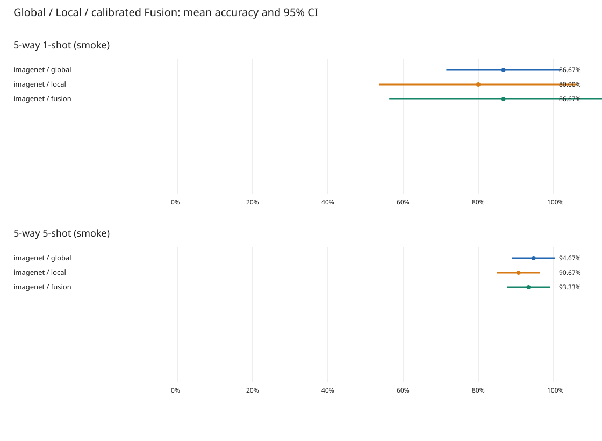

# Global / Local / Fusion 冻结表示对比

模式：**smoke**；实际设备：**NVIDIA GeForce MX450**，dtype=float32。每种Shot实际使用原计划前3个Episode；不重采样，不训练，不读取NABirds。

**smoke结果仅供功能验证，不能代替600-Episode比较。**

| 初始化 | 表示 | Shot | Mean Accuracy | 样本标准差（pp） | 95% CI |
|---|---|---:|---:|---:|---|
| imagenet | global | 1 | 86.667% | 6.110 | [71.488%, 101.845%] |
| imagenet | local | 1 | 80.000% | 10.583 | [53.710%, 106.290%] |
| imagenet | fusion | 1 | 86.667% | 12.220 | [56.310%, 117.023%] |
| imagenet | global | 5 | 94.667% | 2.309 | [88.930%, 100.404%] |
| imagenet | local | 5 | 90.667% | 2.309 | [84.930%, 96.404%] |
| imagenet | fusion | 5 | 93.333% | 2.309 | [87.596%, 99.070%] |

## 数学定义与设备

- Global：原始GAP 512维，原始Support均值Prototype，再计算Cosine。读取旧Global特征和旧Cosine结果；当前设备也用原函数计算Prototype/Cosine以核对旧logits和预测，并供Fusion使用，原结果不覆盖。
- Local：同一权重、同一确定性预处理的Layer4 `[N,512,7,7]`。每图49个512维描述子；在余弦匹配内部对每个描述子除范数，不将局部描述子先平均为原型。
- 每个类汇集K×49个Support描述子；每个Query的49个描述子分别与候选类全部描述子匹配，取Top-3；类分数为49×3个余弦相似度的均值。相似度矩阵为`[query_chunk,49,K*49]`，按Query分块、按类处理。
- Fusion：先对每个Query的每一路五类分数做行内z-score：`z=(s-mean_classes(s))/max(population_std_classes(s),1e-6)`；再用`0.5*z_global+0.5*z_local`。参数预先固定，不使用Query真标签、不拟合温度/模块、不调权重。常数分数行输出零向量。
- 所有前向、Prototype、Cosine、Top-k匹配、校准、Fusion、Softmax与预测在实际评估设备上使用PyTorch执行；CPU只保留完整特征缓存、保存结果和汇总标量统计。smoke额外执行少量CPU前向以核对GPU逻辑。
- Global原始缓存与Local cache分别绑定权重SHA256、预处理及版本、完整Val内容指纹、有序样本ID、FP32/eval状态、计算设备和源码。每次只上传Episode Support和一个Query块，绝不把全部Val Local缓存搬进GPU。
- 初始特征提取Batch Size=8、Query chunk=4，默认匹配2GB显存；不启用AMP/TF32。全程eval、inference_mode，无优化器与反向传播。

## 核验证据与统计

- `feature_binding.json/cache.json`：缓存命中、SHA256、样本顺序、Layer4/GAP对照及提取耗时。
- `*/diagnostics.json/similarity_q0_class0.csv/topk_q0_class0.json`：首个真实Episode维度、匹配矩阵、Top-k及分数范围。
- `*/predictions.jsonl`：每个Episode的ID、类映射、Support/Query、三路完整分数、校准分数、概率和预测；每路Accuracy另存CSV。
- `performance.json/checks.json`：实际设备、总耗时、CUDA峰值allocated/reserved显存、缓存命中和CPU/GPU核验；不使用估算显存伪造实测。
- 使用Episode Accuracy的ddof=1样本标准差，Student-t 95%均值CI；配对差为second−first，在同一个episode_id上计算。smoke仅3个任务，CI很宽且可能超出[0,100]，不作性能结论。

[完整比较表](comparison.csv) · [配对差值](paired_comparison.csv) · [配置](config.json) · [验收](checks.json) · [日志](run.log)

旧`global_local`未校准融合分支保持原样，本次复用底层Global/Local函数并在独立入口执行固定校准。CUB Val曾用于阶段4选择Checkpoint，因此本阶段不是独立最终测试或NABirds跨数据集评估。

## 最终功能验证

17项CUDA回归测试通过：[测试日志](cuda_tests_v2.log)。沙箱内CPU测试15项通过、2项因CUDA不可访问而跳过。另从保存文件核对6个真实Episode的样本ID、三路预测、Softmax概率、固定融合及49×49/49×245相似度矩阵，全部通过。

真实CPU/GPU对照：Layer4最大绝对差约1.14e-4、平均绝对差约3.3e-6，三路分数最大绝对差约8.05e-6，预测一致。FP32跨设备不要求逐位相等。首次过严激活容差失败记录保留在[原始日志](../representation_smoke_imagenet_cuda/failure.log)，未覆盖。

本次是ImageNet功能验证，完整三初始化×两种Shot×600任务**尚未执行**。完整命令见[运行说明](../../../docs/stage05_representation_comparison.md)。

`cuda_tests.log`保留初版合成近常数分数的过严容差失败记录；最终结果以`cuda_tests_v2.log`为准。行内标准化可能放大微小FP32舍入，因此合成测试按严格原始分数误差及标准差传播界限核验，最终预测仍要求一致，算法与校准参数未修改。

性能数据来自缓存命中的smoke，分类计时包含少量CPU对照，不用于外推完整评估速度。完整模式不执行CPU对照前向，所有批量匹配在指定设备执行。
