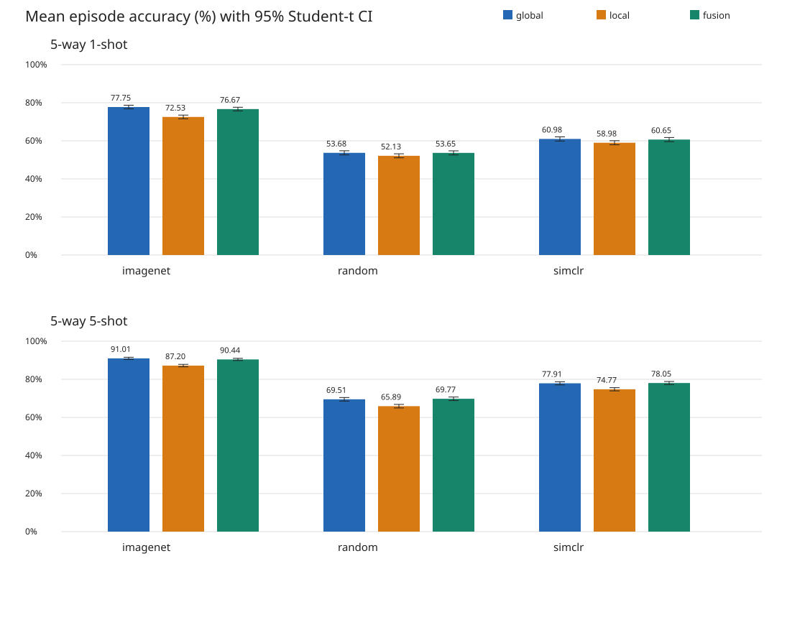
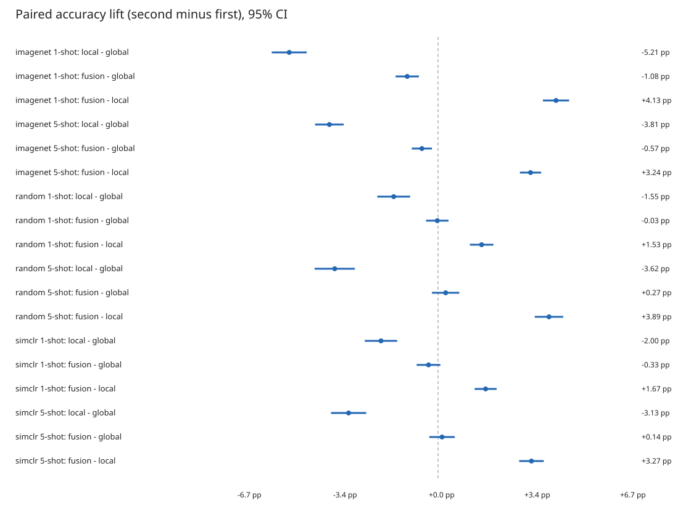
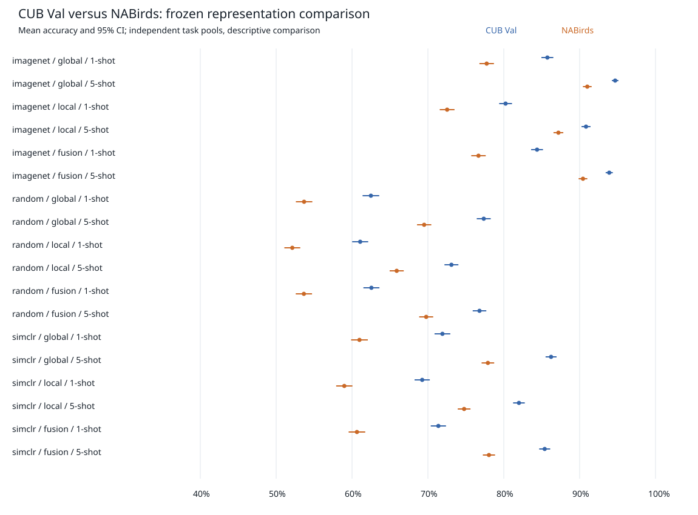

# Stage 06：NABirds 冻结跨数据集 Few-shot 测试

**本结果采用用户明确选择的自动保守物种筛选协议，不声称人工审核通过。** 不训练、不选模型、不搜索权重、不根据NABirds成绩修改任何超参数。

模式：**full**；每种Shot使用冻结计划前600个Episode；实际设备：**NVIDIA GeForce MX450**。
**三种初始化×三种表示×两种Shot×600，共10800次方法评分、270000条Query方法预测，均为本次NABirds新结果。**

## 测试池与语义审核边界

- 原始NABirds：48562图像、555视觉类别、1011层级节点。
- 只使用官方test split(value=0)，合并性别/年龄/外观子类后自动筛选为**317个物种、19307张图像**；物种最少13张，满足5 Support+5 Query。
- 使用固定Cornell eBird taxonomy v2026快照，以规范英文名、所有格拼写、科学名/属及层级作保守筛选。未知或冲突的目标物种整类排除，不能用“没有字符串匹配”冒充确认不重叠。
- CUB Train 100类全部解析为可追溯排除集合；Sayornis、Geococcyx等属级标签排除全属，Great Grey Shrike等历史拆分类名取保守超集，Myrtle Warbler映射并排除Yellow-rumped物种整体。该规则在第一次NABirds前向之前冻结。
- 自动检查不能替代专家物种鉴定；同义名或历史分类残余不确定性仍是限制。`manifest.json`明确human_reviewed=false，原人工审核加载器未被绕过或伪造审批。
- 所有候选实际图片SHA256已核对；派生清单排除与任意CUB split的内容重叠和目标跨类重复。同类重复仅逻辑保留确定性一个文件，不移动/删除任何原图。
- 本协议只要求相对于CUB Train的物种不重叠；不宣称与ImageNet外部预训练物种完全不重叠，也不宣称所有目标物种均未出现在CUB开发验证类别中。

## 完全冻结的模型与任务

- 直接加载Stage04三份best.pth，与Stage05已完成表示实验的Checkpoint SHA256逐项一致，eval+inference_mode、FP32，无优化器，无反向传播。
- 三组Backbone、Global/Local/Fusion共用同一NABirds计划。每种600个5-way任务，每类5 Query；1-shot/5-shot类序、Query完全相同，1-shot Support是5-shot子集。
- 原始GAP512维求均值Prototype再算Cosine；Layer4 49×512描述子使用原DN4函数，类内K×49候选、逐Query位置Top-3，再对49×3项求均值。
- Fusion保留先前固定的每Query五类分数行内population z-score，eps=1e-6，再按0.5/0.5融合；不利用真实Query标签调参。
- 复用同一评分函数及其源码哈希；RGB→Resize257→CenterCrop224→ToTensor→ImageNet像素Normalize，特征与Prototype不做额外预归一化。
- CUDA优先，完整CPU特征缓存按目标manifest、图片ID、权重、模式、预处理与软件版本隔离；只上传Episode Support和Query块，默认Batch8/chunk4，关闭AMP/TF32。

## NABirds 完整比较

| 初始化 | 表示 | Shot | Mean Accuracy | 样本标准差（pp） | 95% CI |
|---|---|---:|---:|---:|---|
| imagenet | global | 1 | 77.747% | 11.920 | [76.791%, 78.702%] |
| imagenet | local | 1 | 72.533% | 12.149 | [71.559%, 73.507%] |
| imagenet | fusion | 1 | 76.667% | 11.898 | [75.713%, 77.621%] |
| imagenet | global | 5 | 91.007% | 7.176 | [90.431%, 91.582%] |
| imagenet | local | 5 | 87.200% | 8.040 | [86.555%, 87.845%] |
| imagenet | fusion | 5 | 90.440% | 7.137 | [89.868%, 91.012%] |
| random | global | 1 | 53.680% | 13.529 | [52.595%, 54.765%] |
| random | local | 1 | 52.127% | 13.071 | [51.079%, 53.175%] |
| random | fusion | 1 | 53.653% | 13.373 | [52.581%, 54.726%] |
| random | global | 5 | 69.507% | 11.709 | [68.568%, 70.445%] |
| random | local | 5 | 65.887% | 11.586 | [64.958%, 66.816%] |
| random | fusion | 5 | 69.773% | 11.492 | [68.852%, 70.695%] |
| simclr | global | 1 | 60.980% | 13.731 | [59.879%, 62.081%] |
| simclr | local | 1 | 58.980% | 13.362 | [57.909%, 60.051%] |
| simclr | fusion | 1 | 60.647% | 13.642 | [59.553%, 61.740%] |
| simclr | global | 5 | 77.907% | 10.326 | [77.079%, 78.735%] |
| simclr | local | 5 | 74.773% | 10.452 | [73.935%, 75.611%] |
| simclr | fusion | 5 | 78.047% | 10.014 | [77.244%, 78.850%] |

## 与CUB Val并列

| 初始化 | 表示 | Shot | CUB Val | NABirds | NABirds−CUB（pp） |
|---|---|---:|---:|---:|---:|
| imagenet | global | 1 | 85.747% | 77.747% | -8.000 |
| imagenet | global | 5 | 94.680% | 91.007% | -3.673 |
| imagenet | local | 1 | 80.240% | 72.533% | -7.707 |
| imagenet | local | 5 | 90.840% | 87.200% | -3.640 |
| imagenet | fusion | 1 | 84.387% | 76.667% | -7.720 |
| imagenet | fusion | 5 | 93.900% | 90.440% | -3.460 |
| random | global | 1 | 62.487% | 53.680% | -8.807 |
| random | global | 5 | 77.360% | 69.507% | -7.853 |
| random | local | 1 | 61.073% | 52.127% | -8.947 |
| random | local | 5 | 73.100% | 65.887% | -7.213 |
| random | fusion | 1 | 62.553% | 53.653% | -8.900 |
| random | fusion | 5 | 76.800% | 69.773% | -7.027 |
| simclr | global | 1 | 71.913% | 60.980% | -10.933 |
| simclr | global | 5 | 86.233% | 77.907% | -8.327 |
| simclr | local | 1 | 69.247% | 58.980% | -10.267 |
| simclr | local | 5 | 82.000% | 74.773% | -7.227 |
| simclr | fusion | 1 | 71.380% | 60.647% | -10.733 |
| simclr | fusion | 5 | 85.393% | 78.047% | -7.347 |

跨数据集差值仅为描述性均值差。CUB Val是50类、NABirds是自动筛选的317类，两个数据集的任务不同，不能按同一个episode_id把跨数据集结果当作配对样本，也不能将差值全归因为纯视觉域偏移。配对统计仅用于同一NABirds任务内三种表示的比较。

## 配对统计、性能和文件

`paired_comparison.csv`报告Local−Global、Fusion−Global、Fusion−Local的均值差及基于600个配对差的Student-t 95% CI，单位百分点；统计描述性，未做多重比较校正。Mean与ddof=1样本标准差、Student-t均值CI沿用Stage05。

[对比表](comparison.csv) · [CUB并列表](cub_vs_nabirds.csv) · [配对差值](paired_comparison.csv) · [逐Episode差值](paired_episode_differences.csv) · [配置](config.json) · [验收](checks.json) · [性能](performance.json) · [日志](run.log)

每模型/Shot的`predictions.jsonl`保存样本ID、类别映射、Support/Query、三路logits/概率/预测及校准分数；对应每路逐Episode Accuracy另存CSV。`protocol/`保留本次manifest与600计划副本，Stage04/05旧文件不覆盖。

总评估耗时：338.01秒。GPU峰值allocated/reserved、提取与分类耗时、完整/部分缓存命中见performance.json；PyTorch峰值不包括驱动上下文或其他进程。

## 分类依据来源

[NABirds官方介绍](https://dl.allaboutbirds.org/nabirds)；[Cornell eBird taxonomy说明](https://support.ebird.org/en/support/solutions/articles/48000837816-the-ebird-taxonomy)；[固定v2026分类CSV](https://api.ebird.org/v2/ref/taxonomy/ebird?fmt=csv&locale=en&version=2026)。实际CSV、版本列表和SHA256保留在Stage06 preflight目录。

## 最终独立验收与运行性能

独立进程验收 **PASS**；27项CUDA回归测试全部通过。独立复核全部19307张选中图片的物理SHA256、317个物种的自动规则一致性、三份Checkpoint的CUB Train类别哈希与类别名称、10800次方法评估及270000条预测。对18个任务探针重新执行CUDA评分，三路logits逐位相等；18项配对统计和18项跨数据集描述性差值均复算一致。自动规则一致性不等于人工物种审核。

实际设备MX450 CUDA，FP32、Batch8、Query chunk4；未发生OOM或CPU回退。主评估总耗时 338.05 秒（不包含先行数据准备、smoke与事后独立复核）。

| 初始化 | 特征阶段耗时(s) | 分类耗时(s) | 已复用图片 | 新提取图片 | CUDA峰值allocated/reserved(MiB) |
|---|---:|---:|---:|---:|---:|
| imagenet | 81.52 | 12.06 | 150 | 14202 | 97.89/194.00 |
| random | 92.70 | 12.70 | 0 | 14352 | 129.99/220.00 |
| simclr | 105.86 | 12.88 | 0 | 14352 | 129.99/220.00 |

每个Backbone只缓存600对任务实际涉及的14352张图像；每份Local缓存约1.44GB，保存在CPU侧。ImageNet安全复用smoke的150张，Random/SimCLR首次提取。上述特征阶段耗时包含该阶段缓存处理；PyTorch显存统计不包含驱动上下文。

配对分析中Local在六组配置下均低于Global，差值95% CI均不含0。Fusion对ImageNet的两种Shot低于Global；Random 1-shot/5-shot、SimCLR 1-shot/5-shot的Fusion−Global区间均含0。因此Random、SimCLR 5-shot的小幅正均值差不能解释为稳定提升。六组Fusion均高于Local，其配对区间不含0；这些均为未做多重比较校正的描述性区间。

[独立验收JSON](independent_verification.json) · [独立验收日志](independent_verification.log) · [CUDA回归测试日志](../tests/cuda_tests.log) · [PNG准确率图](accuracy_bars.png) · [PNG配对图](paired_lifts.png)

原Stage04权重、Stage05结果及原始图片/划分保持不变，前后哈希检查通过。复现命令及筛选细节见仓库`docs/stage06_nabirds_automatic.md`；`command.json`保存实际主运行命令。
