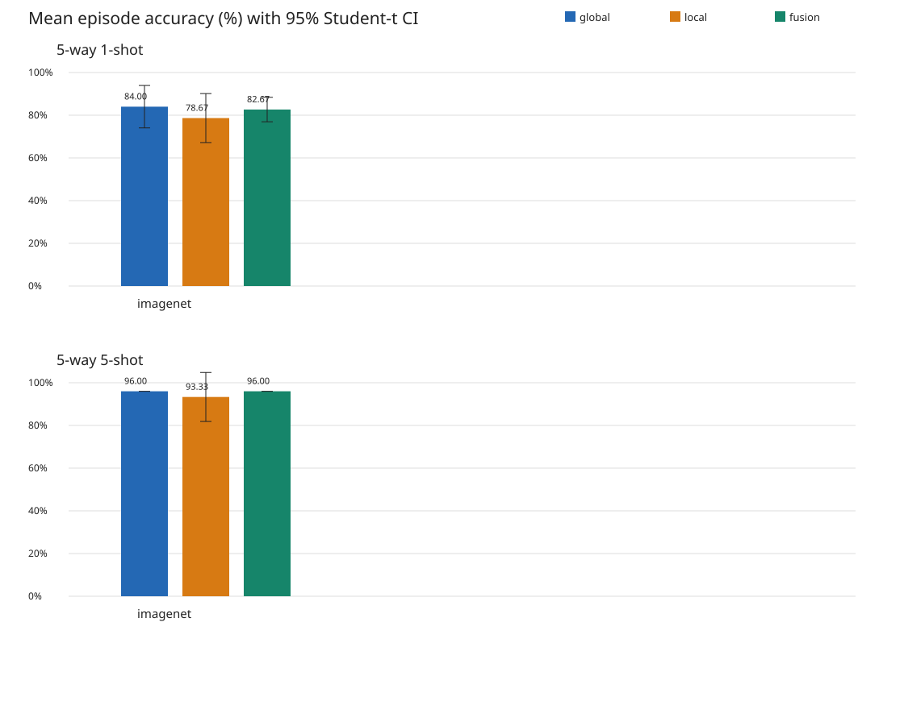
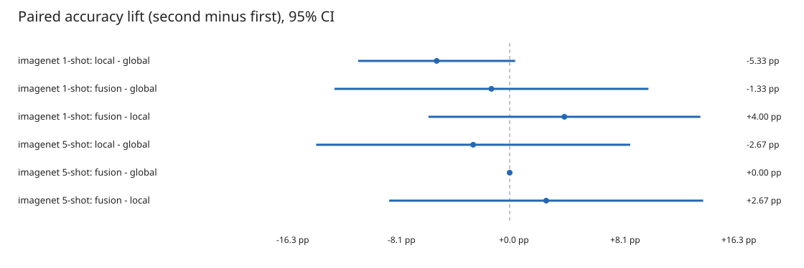

# Stage 06：NABirds 冻结跨数据集 Few-shot 测试

**本结果采用用户明确选择的自动保守物种筛选协议，不声称人工审核通过。** 不训练、不选模型、不搜索权重、不根据NABirds成绩修改任何超参数。

模式：**smoke**；每种Shot使用冻结计划前3个Episode；实际设备：**NVIDIA GeForce MX450**。
smoke只用于功能检查，不能当作600任务结果。

## 测试池与语义审核边界

- 原始NABirds：48562图像、555视觉类别、1011层级节点。
- 只使用官方test split(value=0)，合并性别/年龄/外观子类后自动筛选为**317个物种、19307张图像**；物种最少13张，满足5 Support+5 Query。
- 使用固定Cornell eBird taxonomy v2026快照，以规范英文名、所有格拼写、科学名/属及层级作保守筛选。未知或冲突的目标物种整类排除，不能用“没有字符串匹配”冒充确认不重叠。
- CUB Train 100类全部解析为可追溯排除集合；Sayornis、Geococcyx等属级标签排除全属，Great Grey Shrike等历史拆分类名取保守超集，Myrtle Warbler映射并排除Yellow-rumped物种整体。该规则在第一次NABirds前向之前冻结。
- 自动检查不能替代专家物种鉴定；同义名或历史分类残余不确定性仍是限制。`manifest.json`明确human_reviewed=false，原人工审核加载器未被绕过或伪造审批。
- 所有候选实际图片SHA256已核对；派生清单排除与任意CUB split的内容重叠和目标跨类重复。同类重复仅逻辑保留确定性一个文件，不移动/删除任何原图。
- 本协议只要求相对于CUB Train的物种不重叠；不宣称与ImageNet外部预训练物种完全不重叠，也不宣称所有目标物种均未出现在CUB开发验证类别中。

## 完全冻结的模型与任务

- 直接加载Stage04三份best.pth，与Stage05已完成表示实验的Checkpoint SHA256逐项一致，eval+inference_mode、FP32，无优化器，无反向传播。
- 三组Backbone、Global/Local/Fusion共用同一NABirds计划。每种600个5-way任务，每类5 Query；1-shot/5-shot类序、Query完全相同，1-shot Support是5-shot子集。
- 原始GAP512维求均值Prototype再算Cosine；Layer4 49×512描述子使用原DN4函数，类内K×49候选、逐Query位置Top-3，再对49×3项求均值。
- Fusion保留先前固定的每Query五类分数行内population z-score，eps=1e-6，再按0.5/0.5融合；不利用真实Query标签调参。
- 复用同一评分函数及其源码哈希；RGB→Resize257→CenterCrop224→ToTensor→ImageNet像素Normalize，特征与Prototype不做额外预归一化。
- CUDA优先，完整CPU特征缓存按目标manifest、图片ID、权重、模式、预处理与软件版本隔离；只上传Episode Support和Query块，默认Batch8/chunk4，关闭AMP/TF32。

## NABirds 完整比较

| 初始化 | 表示 | Shot | Mean Accuracy | 样本标准差（pp） | 95% CI |
|---|---|---:|---:|---:|---|
| imagenet | global | 1 | 84.000% | 4.000 | [74.063%, 93.937%] |
| imagenet | local | 1 | 78.667% | 4.619 | [67.193%, 90.140%] |
| imagenet | fusion | 1 | 82.667% | 2.309 | [76.930%, 88.404%] |
| imagenet | global | 5 | 96.000% | 0.000 | [96.000%, 96.000%] |
| imagenet | local | 5 | 93.333% | 4.619 | [81.860%, 104.807%] |
| imagenet | fusion | 5 | 96.000% | 0.000 | [96.000%, 96.000%] |

## 与CUB Val并列

| 初始化 | 表示 | Shot | CUB Val | NABirds | NABirds−CUB（pp） |
|---|---|---:|---:|---:|---:|
| imagenet | global | 1 | 85.747% | 84.000% | -1.747 |
| imagenet | global | 5 | 94.680% | 96.000% | +1.320 |
| imagenet | local | 1 | 80.240% | 78.667% | -1.573 |
| imagenet | local | 5 | 90.840% | 93.333% | +2.493 |
| imagenet | fusion | 1 | 84.387% | 82.667% | -1.720 |
| imagenet | fusion | 5 | 93.900% | 96.000% | +2.100 |

跨数据集差值仅为描述性均值差。CUB Val是50类、NABirds是自动筛选的317类，两个数据集的任务不同，不能按同一个episode_id把跨数据集结果当作配对样本，也不能将差值全归因为纯视觉域偏移。配对统计仅用于同一NABirds任务内三种表示的比较。

## 配对统计、性能和文件

`paired_comparison.csv`报告Local−Global、Fusion−Global、Fusion−Local的均值差及基于600个配对差的Student-t 95% CI，单位百分点；统计描述性，未做多重比较校正。Mean与ddof=1样本标准差、Student-t均值CI沿用Stage05。

[对比表](comparison.csv) · [CUB并列表](cub_vs_nabirds.csv) · [配对差值](paired_comparison.csv) · [逐Episode差值](paired_episode_differences.csv) · [配置](config.json) · [验收](checks.json) · [性能](performance.json) · [日志](run.log)

每模型/Shot的`predictions.jsonl`保存样本ID、类别映射、Support/Query、三路logits/概率/预测及校准分数；对应每路逐Episode Accuracy另存CSV。`protocol/`保留本次manifest与600计划副本，Stage04/05旧文件不覆盖。

总评估耗时：21.22秒。GPU峰值allocated/reserved、提取与分类耗时、完整/部分缓存命中见performance.json；PyTorch峰值不包括驱动上下文或其他进程。

## 分类依据来源

[NABirds官方介绍](https://dl.allaboutbirds.org/nabirds)；[Cornell eBird taxonomy说明](https://support.ebird.org/en/support/solutions/articles/48000837816-the-ebird-taxonomy)；[固定v2026分类CSV](https://api.ebird.org/v2/ref/taxonomy/ebird?fmt=csv&locale=en&version=2026)。实际CSV、版本列表和SHA256保留在Stage06 preflight目录。
